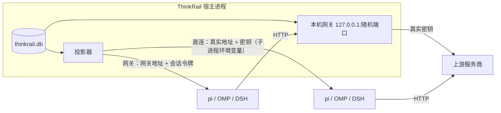

# Agent 设置方案：模型、提供方、MCP 服务器

状态：方案草案，2026-10-31。依据 [01 调研](01-research.md)。标记沿用多 Agent 设计包：**实测**、**源码**、`[INFERENCE]`、**设计**。

## 1. 已确认的用户决定

| 编号 | 决定 |
|---|---|
| S01 | 提供方（含 API 密钥）和 MCP 配置存进 SQLite 数据库，位置在可执行文件同目录的 `data/` 下；数据库用 Turso 的最新正式版 |
| S02 | 提供方全局一份，所有 Agent 档案共用 |
| S03 | MCP 服务器有全局配置，项目可以覆盖全局 |
| S04 | 先支持 OpenAI 协议和 Claude 协议，按 Cherry 的做法：Claude 协议即 `anthropic-messages` 端点，一个提供方可同时配置 OpenAI 和 Claude 两个地址 |
| S05 | 模型要能声明“支持图像输入” |
| S06 | 投影和网关两种接入方式都要支持 |
| S07 | API 密钥在界面中可以回显（掩码 + 显示 / 复制），参考 Cherry |
| S08 | API 密钥不加密，明文存在数据库里 |
| S09 | 默认直连；网关是后备（引擎不支持该协议时）或用户主动选择，与 Cherry 一致 |
| S10 | 一个提供方可配置多个 API 密钥并轮换使用，参考 Cherry |

## 2. 数据库选型

Turso 名下有两个 Rust 库，加上通用的 rusqlite 作对照（版本取自 crates.io，2026-10-31）：

| | `turso` | `libsql` | `rusqlite`（对照） |
|---|---|---|---|
| 最新正式版 | 0.8.3（2026-10-12；0.9.0 仍是 pre） | 0.10.0（2026-10-13） | 0.41.1 |
| 实现 | 纯 Rust 重写的 SQLite 兼容引擎 | SQLite 的 C 分支 | 绑定官方 SQLite（C） |
| 定位 | Turso 官方“今后的方向”，开发重心所在；未到 1.0，官方建议自行备份 | 运行时间更长，但官方已转向 `turso` | 成熟稳定，与 Turso 无关 |
| API | 异步（`Builder::new_local(path).build().await`、`conn.execute(..).await`） | 异步 | 同步 |
| Windows | 支持 | 支持，需要 C 编译链 | 支持，需要 C 编译链或捆绑编译 |
| 静态加密 | 有，但标为实验性（`experimental-encryption`，“不要用于重要数据”） | 有（基于 SQLCipher） | 需 SQLCipher |

选择 **`turso` 0.8.3**，精确锁定。理由：符合 S01 的“Turso 最新正式版”；引擎本身是纯 Rust（不链接 SQLite 的 C 代码）；与项目 U03（最新正式版）一致。构建时仍需要 Windows SDK 的资源编译器 `rc.exe`（见下）。

M0 实测（2026-10-31，Windows，`turso` 0.8.3 关闭默认特性，`pollster` 1.0.1 在普通线程上 `block_on`，不引入 tokio）：

- 主键重复、`UNIQUE (provider_id, key)` 重复、外键指向不存在的行都被拒绝（错误信息如 `UNIQUE constraint failed: provider_keys.(provider_id, key)`）。所以主键和唯一约束不受“索引是实验性”那句话影响。
- `BEGIN … ROLLBACK` 正确丢弃写入；带参数的有序查询、`NULL` 值、中文文本正常。
- 重新打开文件后数据都在；`ON DELETE CASCADE` 生效，但 `PRAGMA foreign_keys = ON` 是**每个连接**的设置（与 SQLite 相同），每次打开连接都要执行。
- 生成的文件头是 `SQLite format 3`，可以用普通 SQLite 工具打开。
- 编译需要 Windows SDK 的 `rc.exe`（`turso_sdk_kit` 的构建脚本要编译版本资源），见 §2.1。

仍需注意的风险：

- **未到 1.0**：官方建议自行备份。
- **并发**：多个窗口或进程同时打开同一个库的行为；多进程 WAL 在 Windows 上标为实验性。本应用按单进程使用。
- **不使用库的静态加密**：它是实验性的；按 S08，本期密钥明文存储（见 §3.3）。

## 3. 存储（设计）

### 3.1 位置

- 数据库文件：`<可执行文件所在目录>/data/thinkrail.db`。启动时指定了 `--data-dir` 时改为 `<data-dir>/thinkrail.db`，测试和多实例因此互不干扰。
- JSON 数据（档案、工作区、计划审查、终端目录）和日志默认位于 `~/.autorail`，不自动导入原版或旧原生版目录（§9）。
- 便携目录要求可执行文件所在目录可写；安装到 `Program Files` 时不可写，启动时报错并提示用 `--data-dir`。

### 3.2 表

| 表 | 主要字段 | 说明 |
|---|---|---|
| `providers` | `id`（UUID）、`name`、`headers`（JSON，额外请求头）、`default_protocol`、`access`（`direct` / `gateway`）、`enabled`、`revision`、时间戳 | 全局，所有档案共用（S02） |
| `provider_keys` | `id`（UUID）、`provider_id`、`key`（明文）、`label`（可空）、`enabled`、`sort` | 一个提供方多个密钥（S10）；`(provider_id, key)` 唯一；`sort` 决定轮换顺序 |
| `provider_endpoints` | `provider_id`、`protocol`（`openai-chat` / `openai-responses` / `anthropic-messages`）、`base_url` | 主键 `(provider_id, protocol)`；同一个中转可同时提供 OpenAI 和 Claude 两种地址（参考 Cherry 的 `endpointConfigs`） |
| `provider_models` | `provider_id`、`model_id`、`name`、`protocols`（JSON，有序，首个为默认）、`context_window`、`max_tokens`、`vision`、`reasoning`、`tools`、`efforts`（JSON）、`enabled`、`sort` | 主键 `(provider_id, model_id)`；`vision` 对应 S05 |
| `model_prefs` | `key`、`value` | 默认模型 `provider_id/model_id`、默认力度、被隐藏的模型列表 |
| `mcp_servers` | `id`、`name`、`scope`（`global` / `project`）、`project_id`（项目级才有）、`transport`（`stdio` / `http`）、`command`、`args`（JSON）、`env`（JSON）、`url`、`headers`（JSON）、`enabled`、`revision` | 名称在同一范围内唯一 |
| `mcp_project_overrides` | `project_id`、`server_id`、`enabled` | 项目对全局服务器的启用或停用（S03） |
| `schema_meta` | `version` | 迁移版本号；读到更新的版本时报 `CORRUPT`，不覆盖（沿用多 Agent 设计包 04 §7） |

项目级生效规则：先取全局服务器，再按 `mcp_project_overrides` 启用或停用；同名的项目级服务器替换全局服务器。

### 3.3 API 密钥的存储与显示

- 按 S08，密钥以明文存在 `thinkrail.db` 里，数据库文件拷到别的机器可以直接用。代价：任何能读这个文件的程序或人都能拿到密钥；`data/` 目录不要放进同步盘或版本库。
- 界面回显密钥，参考 Cherry（`ProviderSettings/ConnectionSettings/ApiKey.tsx`、`shared/utils/api/format.ts`）：
  - 默认显示掩码：长度大于 8 时为“前 2 位 + `****` + 后 4 位”，否则显示 `••••••••`；等宽字体。
  - 行内“显示 / 隐藏”（眼睛图标）切换明文；“复制”把明文写入剪贴板；“编辑”打开输入框（密码框，同样带显示切换）；“删除”清除密钥。切换到另一个提供方时回到掩码状态。
  - 列表只显示掩码，明文只在用户点“显示”或“复制”时从库中取出。
  - 多密钥与轮换见 §3.4。
- 日志、错误消息、stderr 摘要都不得出现密钥（沿用多 Agent 设计包 04 §3）。
- 环境变量和请求头的值允许写成 `$VAR` 引用启动环境中的变量（与原版一致）；写明文值时同样以明文存储。

### 3.4 多密钥与轮换（S10，参考 Cherry 01 §4.5）

- 每个提供方可以有多个密钥，每个有标签和启用开关；密钥值去首尾空白，不能为空，同一提供方内不能重复。
- **选择规则**（照搬 Cherry `resolveApiKey`）：只在已启用的密钥里选；0 个视为未配置；1 个直接用；多个时轮询，宿主进程内记住每个提供方上一次用的密钥 id，下一次取后一个，到末尾回到第一个；不落盘，重启后从第一个开始。显式指定的密钥（检测某一个时）不参与轮换。
- **轮换何时推进**，取决于接入方式：
  - **直连**：密钥要在引擎进程启动时放进它的环境变量，所以**每启动一次引擎进程轮换一次**，这个进程里的所有请求都用同一个密钥（与 Cherry 的 pi、Claude Code 会话相同）。
  - **网关**：宿主转发每个请求时选一次，**每个请求轮换一次**（与 Cherry 应用内对话相同）。失败不换密钥重试，上游错误原样返回（Cherry 同样不按失败重试）。
- 只读路径不推进轮换：签名计算、启动前校验、界面加载列表。
- 签名只包含**已启用密钥的集合**（与 Cherry 一致），轮换本身不会让引擎重启；增删、启停密钥会。
- 日志只记录密钥 id 或标签，不记录密钥值。
- **界面**（对标 Cherry）：
  - 提供方对话框的密钥行显示第一个已启用密钥的掩码，多于一个时后面显示“+N”；行内显示 / 隐藏、复制、编辑、删除。
  - “API 密钥管理”列表：说明“管理当前服务商的多个 API Key”；每行标签（未填为“API Key”）、掩码、复制、编辑、删除、启用开关；底部“添加 API 密钥”；页脚“N / M 已启用”；空时“API 密钥未配置”；错误“API 密钥不能为空”“API 密钥已存在”。
  - “检测所有密钥”：对每个已启用密钥用所选模型各发一次最小请求，逐条显示标签、掩码、通过 / 失败、耗时、错误信息和启用开关。

## 4. 接入方式：投影与网关（设计，S06）

每个提供方有一个 `access` 字段，在提供方对话框里选择。按 S09 默认“直连”；提供方的协议某个引擎不支持时，该引擎自动改走网关（与 Cherry 相同：能直连就直连，网关是后备或用户主动选择）。

两种方式都要把提供方“投影”成引擎能读的配置，区别只在投影出去的地址和密钥：

| | 直连（投影） | 网关 |
|---|---|---|
| 引擎看到的地址 | 上游真实地址 | `http://127.0.0.1:<端口>/<提供方路由>` |
| 引擎拿到的密钥 | 真实密钥，只放在子进程的环境变量里 | 宿主为本次引擎进程生成的随机令牌 |
| 真实密钥是否进入引擎进程 | 是 | 否 |
| 宿主工作量 | 只生成配置 | 生成配置 + 网关转发 |
| 适用 | 默认 | 用户主动选择；引擎不支持该协议时自动使用；以后扩展更多协议、用量统计的基础 |

### 4.1 投影到各引擎

宿主在每次启动引擎时生成配置，写在宿主数据目录下的引擎辅助目录（`<data>/engines/<档案 id>/`），不改用户的引擎配置目录（与现有 DSH `--patch` 做法一致）：

| 引擎 | 提供方投影 | 密钥投影 | 默认模型 |
|---|---|---|---|
| pi | `-e` 扩展调用 `registerProvider`（不写 `models.json`） | `apiKey: "$THINKRAIL_PROVIDER_<短 id>_KEY"`，值放进子进程环境 | 启动参数 `--model 提供方/模型 --thinking 档位` |
| OMP | `-e` 扩展调用 `registerProvider`（M0 实测：RPC 模式生效） | `apiKey: "THINKRAIL_PROVIDER_<短 id>_KEY"` + `auth: "apiKey"` | `--config <yml>` 覆盖层写 `modelRoles.default: 提供方/模型[:档位]`（M0 实测生效，不改用户的 `config.yml`） |
| DSH | `--patch` 覆盖层写 `llm-pi-ai.providers` 和 `acp` 入口 | `apiKeyEnv: THINKRAIL_PROVIDER_<短 id>_KEY` | `acp: {provider, model}`；力度在 `session/new` 后用 `session/set_config_option` 设置 |

- 路由名用提供方 UUID 的前 12 位：`thinkrail-<短 id>`，与用户自己的条目区分开（参考 Cherry 的归属标记做法）。
- 协议选择（沿用 Cherry `resolveEffectiveEndpoint`）：引擎偏好的协议（若模型声明了且提供方配置了地址）→ 模型的第一个协议 → 提供方的默认协议。三个引擎都支持 `anthropic-messages`，模型同时声明 OpenAI 和 Claude 时优先 Claude（与 Cherry 投影 pi 时相同）。
- 模型字段按引擎拼写：`vision` → `input: [text, image]`；`reasoning` + `efforts` → pi/OMP 的 `reasoning` 和档位映射、DSH 的 `reasoningEfforts`。不推理的模型在 DSH 写 `reasoningEfforts: false`；推理模型只映射用户声明过的档位，未声明的不发（Cherry 的教训：发了默认 `medium`，严格的端点会拒绝）。
- 地址规则沿用 Cherry `formatApiHost` / `withoutTrailingApiVersion`：去掉首尾空白和末尾 `/`；末尾 `#` 表示原样使用、不自动补版本。OpenAI 类地址自动补 `/v1`（已含 `/v<数字>` 时不补）；Claude 地址交给三个引擎时**去掉**末尾的 `/vN`，因为 Anthropic SDK 会自己拼 `/v1/messages`。
- Claude 协议的鉴权：同时可用 `x-api-key` 和 `Authorization: Bearer`（Cherry 对中转两者都发）；OMP 的 `anthropic-messages` 提供方必须写 `auth: apiKey`。额外请求头值里的 `$`、开头的 `!` 要转义，pi 会把它们当模板解析（Cherry `toPiHeaders`）。
- 启动前从继承的环境中删掉 `THINKRAIL_PROVIDER_*`，防止残留变量覆盖。
- 图像（S05，沿用 Cherry `isVisionModel`）：模型 `vision = true` 才投影 `input: [text, image]`。没有自动识别：查找模型时若上游返回了能力信息就采用，否则默认关闭，由用户在模型行里打开“视觉”。
- 查找模型：OpenAI 类 `GET {地址}/v1/models`；Claude 类同样请求 `{地址}/v1/models`，同时带 `x-api-key`、`Authorization: Bearer` 和 `anthropic-version: 2023-06-01`（Cherry 对 Anthropic 官方只用 `x-api-key`，对中转用两者）。“检测”用所选模型发一次最小请求，15 秒超时、不重试（Cherry `checkModel`）。

### 4.2 网关

- 宿主启动时在 `127.0.0.1` 随机端口起一个 HTTP 服务（只监听回环地址，不对外）。
- 每个引擎进程分到一个随机令牌（内存中，不落盘），引擎退出即作废；请求必须带 `Authorization: Bearer <令牌>` 或 `x-api-key: <令牌>`，否则 401。
- 路径按提供方路由：`/p/<短 id>/v1/chat/completions`、`/v1/responses`、`/v1/models`（OpenAI），`/p/<短 id>/v1/messages`（Anthropic）。
- 本期**同协议透传**：引擎用哪种协议，上游就是哪种协议；网关只替换鉴权头（换成真实密钥）、地址，流式响应原样转发。跨协议转换（例如 Anthropic → OpenAI）不在本期。
- 不记录请求体和响应体；日志只记提供方 id、状态码、耗时。
- 网关是本机服务：不带令牌的请求一律拒绝；端口不固定。
- 实现（沿用多 Agent 设计包 U02：业务全部用 Rust），全部精确锁定：服务端 `hyper` 1.12.0 + `hyper-util` 0.1.21 + `http-body-util` 0.1.5，运行在 `tokio` 1.54.1 上；上游客户端 `reqwest` 0.13.5（`default-features = false`，开 `rustls-no-provider`、`stream`、`http2`）；TLS 用 `rustls` 0.23.46 的 `ring` 后端（关掉默认的 `aws-lc-rs`，它依赖 C 库和 NASM），根证书由 `rustls-platform-verifier` 读 Windows 证书库。网关只监听 `127.0.0.1`，自身不需要 TLS，TLS 只用在连上游。
- M0 实测（便携 MSVC 下编译）：回环随机端口监听；不带令牌返回 401；带令牌时经 rustls（ring）+ Windows 证书库请求 HTTPS 上游，状态 200，响应分块流式转发；依赖树里没有 `aws-lc`、`openssl`、`native-tls`。`ring` 本身含少量 C 和汇编，由便携 MSVC 编译。

### 4.3 何时生效

- 每次启动引擎时按当前配置投影；对一个提供方、模型、MCP 集合和默认模型算一个签名（参考 Cherry）。
- 签名变化后，已启动的引擎**在空闲时**重启，下一条消息用新配置；运行中的回合不打断。
- 已有聊天恢复时仍按自己的档案版本启动，但提供方和模型取当前配置（提供方是全局的，没有版本）。被删除的提供方或模型，聊天头部显示“模型不可用”，不自动换用其他模型（与多 Agent 设计包“不自动换用后端”一致）。

## 5. MCP 服务器（设计，S03）

- 范围：全局（所有项目）和项目级（只对某个项目）。项目可以停用某个全局服务器，也可以定义同名的项目级服务器替换它。
- 传输：stdio（命令 + 参数 + 环境变量）和 HTTP（URL + 请求头）。名称 `^[A-Za-z0-9_-]{1,32}$`；环境变量和请求头的值可以写 `$VAR`。
- 投影到各引擎（启动聊天时按该聊天所在项目计算生效集合）：
  - pi：在现有 `-e` 扩展里额外调用 `registerMcpServer`。
  - DSH：追加到 `session/new` / `session/resume` 的 `mcpServers`。DSH 的 MCP 服务器启动失败会让整个会话创建失败，宿主要把失败的服务器名报给用户。
  - OMP：RPC 模式没有注入接口，扩展 API 也没有 `registerMcpServer`；`--config` 覆盖层只承载 `config.yml` 类设置，不能放 MCP 服务器。M0 实测可行的做法是写配置目录下的 `mcp.json`，这是用户自己的 OMP 配置文件。所以宿主**合并**写入：只增删名字以 `thinkrail-` 开头的条目，保留用户的其他条目和未知字段，原子替换（参考 Cherry 的归属标记做法）。覆盖层同时设置 `mcp.enableProjectConfig: false`，避免 OMP 读取项目里 `.claude`、`.cursor` 等外部配置。M0 中项目内 `.claude/mcp.json` 和根目录 `mcp.json` 在有无这个设置时都没有被加载，泄漏没有复现；这个设置仍然保留，作为防护。
- 本期不做：运行状态与工具数、日志、重新连接、OAuth 登录、暴露级别、仓库内 `.pi/mcp.json` 的审批。这些依赖引擎上报，三个协议里目前都没有对应事件 `[INFERENCE]`。

## 6. 界面（设计，对标原版 01 §1）

- 设置对话框改为左侧导航：AGENT 分组下“模型”“提供方”“MCP 服务器”“Agent 档案”（现有页面迁入）。原版其他分组和页面本期不放，不做空壳。尺寸、分组标题、行布局按 01 §1.1–1.2。
- **模型页**：“默认模型”组：会话模型（下拉，按提供方分组）+ 力度（档位来自模型声明）；可见模型（行内展开、搜索、开关，只记录隐藏项）。原版的评审组和 GPT 上下文窗口不做（原生版无评审功能）。
- **提供方页**：说明文字 + “添加提供方”；每行显示名称、地址、模型数、接入方式（网关 / 直连）、编辑、删除。对话框字段（参考 Cherry `ProviderEditorDrawer`、`ApiHost.tsx`）：
  - 名称；**API 地址**（OpenAI）和 **Anthropic API 地址**（“仅当服务商提供 Claude 兼容的基础地址时填写。”），各带“预览：{{完整请求地址}}”；提示“在末尾添加 # 以禁用自动附加的 API 版本。”；“更多端点”可加 OpenAI Responses 地址；默认协议（OpenAI / Anthropic / OpenAI Responses）；附本地预设。
  - API 密钥：掩码回显 + 显示 / 复制 / 编辑 / 删除，见 §3.3。
  - 额外请求头（键值）；接入方式。
  - 模型列表：“查找模型”；手动添加；每个模型可设端点类型（多选、有序，首个为默认）、上下文、最大输出、**视觉**、推理与档位、工具；“检测”。
  - 编辑时不能改地址的 origin（沿用原版）。删除前确认。
- **MCP 页**：顶部选择“全局”或当前项目；列表每行显示名称、范围、传输方式、启用开关、编辑、删除；项目视图里全局服务器显示“来自全局”，开关表示本项目是否启用。添加对话框：表单 / 粘贴 JSON、预设（沿用原版 Context7、DeepWiki 等）、名称、传输方式、命令 / 参数 / 环境变量或 URL / 请求头。
- 聊天头部：模型名可点击切换（pi/OMP 用 `set_model`、DSH 用 `session/set_config_option`），只对当前会话生效。
- 文案用中文常量（现有约定）；颜色、尺寸只用主题角色和 metrics。

## 7. 里程碑

| 里程碑 | 内容 | 完成标志 | 任务（05） |
|---|---|---|---|
| M0 技术验证 | 已完成，结论写在 §2、§4.1、§5 | 一次性验证脚本的输出（已删除） | — |
| M1 存储与服务 | `settings-store` crate：表、迁移；`ProviderService`（含多密钥与轮询选择）、`McpService`、`ModelPrefs` trait 与实现 | 单元测试（临时目录、占位密钥）：轮询顺序、跳过停用密钥、重复与空值被拒、只读路径不推进轮换 | T1、T2 |
| M2 投影 | 三个引擎的投影器 + 启动环境注入 + 签名与空闲重启；直连方式 | 真实窗口：三个引擎都用 easyclaude 中转跑通一轮，并能识别图片 | T3、T6、T7、T10 |
| M3 网关 | 回环网关、令牌、OpenAI Chat / Responses / Anthropic 透传、流式、按请求轮换密钥 | 真实窗口：网关方式下三个引擎各跑通一轮；无令牌请求被拒；两个密钥时上游依次收到不同密钥 | T4 |
| M4 界面 | 左侧导航、模型页、提供方页、MCP 页、聊天头部切换模型 | 真实窗口逐页操作并截图 | T5、T9、T11–T14 |
| M5 MCP 投影 | 全局 / 项目覆盖的生效集合，pi / DSH / OMP 三种投影 | 真实窗口：三个引擎都能调用一个用户配置的 MCP 服务器的工具 | T8、T13 |

全部里程碑的端到端验收在 T15 完成。

## 8. 本期不做

- 跨协议转换（例如引擎用 Anthropic、上游是 OpenAI）；Gemini 等其他协议。
- 订阅登录（OAuth）、JetBrains AI、评审模型与开关、GPT 上下文窗口。
- MCP 运行状态、工具数、日志、重新连接、OAuth、暴露级别、仓库内配置审批。
- 用量统计与计费。

## 9. 待确认

暂无。决定记录：

- 数据位置：数据库放进 `<exe 目录>/data/`；档案、工作区、计划审查、终端目录和日志默认位于 `~/.autorail`。显式 `--data-dir` 时统一使用指定目录；不自动迁移旧目录。
- 密钥不加密（S08）。
- 默认直连，网关为后备或主动选择（S09，与 Cherry 一致）。
- “Claude Code 模型的协议”按 `anthropic-messages` 端点实现；把 Claude Code 作为第四种 Agent 接入不在本期（S04 补充）。
