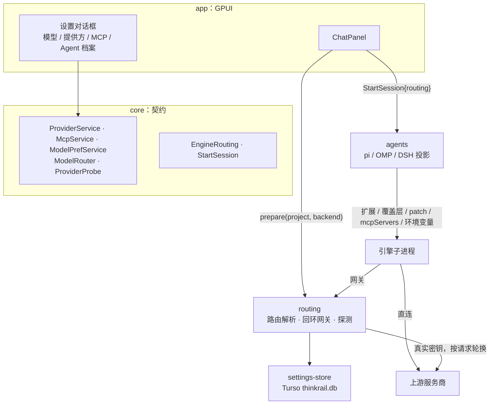
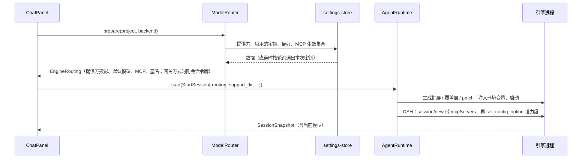

# 03 概要设计：模型、提供方、MCP 服务器

事实见 [01 调研](01-research.md)，决定与 M0 实测见 [02 方案](02-plan.md)，接口见 [04 详细设计](04-detail.md)，执行见 [05 任务](05-tasks.md)。本文沿用多 Agent 设计包的分层原则（[03](../native-multi-agent/03-architecture.md) §2），只描述本特性新增和改变的部分。

## 1. 目标与边界

- 用户在设置里配置一次**全局提供方**（多个端点、多个密钥、模型列表）、**默认模型与力度**、**MCP 服务器**（全局 + 项目覆盖），pi、OMP、DSH 三个引擎都能用上（S02、S03）。
- 提供方的接入方式有直连和网关两种，默认直连（S06、S09）。
- **没有配置任何提供方时不投影**：引擎照旧读自己配置目录里的模型，行为与现在一致。这保证升级前后已有档案都能继续工作。
- 本期不做的内容见 02 §8。

## 2. 系统结构

## 3. Crate 分层

| crate | 职责 | 依赖 | 禁止 |
|---|---|---|---|
| `core`（改） | 新增领域类型（提供方、端点、模型、密钥、MCP、偏好、路由结果）和 5 个 trait；`StartSession` 增加 `routing` 与 `support_dir` | 不变 | I/O、网络 |
| `settings-store`（新） | 用 Turso 实现 `ProviderService`、`McpService`、`ModelPrefService`；表结构与迁移；密钥轮询游标 | core、turso、pollster | 网络、GPUI |
| `routing`（新） | 实现 `ModelRouter`（把存储内容解析成某次启动用的 `EngineRouting`）和 `ProviderProbe`（查找模型、检测）；回环网关 | core、tokio、hyper、reqwest、rustls（ring） | GPUI、引擎专有格式 |
| `agents`（改） | 把 `EngineRouting` 投影成三种引擎各自的配置；支持运行中切换模型 | core（不变） | 读数据库、发上游请求 |
| `app`（改） | 设置页、组装根、聊天启动时调用 `ModelRouter`、配置变化后空闲重启 | 新增依赖 settings-store、routing（只在组装根实例化） | 视图直接读库或发请求 |

规则不变：视图只持有 `Arc<dyn Trait>`；具体类型只在 `app::services::build` 中创建；每个 crate 的 `lib.rs` 是唯一入口。`agents` 不依赖 `settings-store` 或 `routing`，只认 core 里的 `EngineRouting`。

## 4. 状态归属

| 状态 | 权威所有者 | 其他层保存的内容 |
|---|---|---|
| 提供方、端点、模型、密钥 | `ProviderService`（`thinkrail.db`） | 设置页的投影；列表只含掩码，不含明文 |
| 默认模型、默认力度、被隐藏的模型 | `ModelPrefService`（`thinkrail.db`） | 设置页投影 |
| MCP 服务器、项目覆盖 | `McpService`（`thinkrail.db`） | 设置页投影 |
| 密钥轮询游标 | `settings-store` 进程内存（每个提供方上一次用的密钥 id） | 不持久化，重启后从第一个开始 |
| 网关会话令牌 | `routing` 进程内存 | 只在对应引擎子进程的环境变量里 |
| 某次启动用的路由 `EngineRouting` | 启动时由 `ModelRouter::prepare` 生成 | `ChatPanel` 记住其签名，用来判断是否需要重启 |
| 引擎内的当前模型、力度 | 引擎自身（会话级，不写回配置） | `SessionSnapshot.model` |
| 档案、聊天绑定、引擎原生会话 | 不变（多 Agent 设计包 03 §3） | 不变 |

数据库位置：`<exe 目录>/data/thinkrail.db`；指定 `--data-dir` 时为 `<data-dir>/thinkrail.db`。其余 JSON 数据和日志位置不变（02 §3.1）。

## 5. 核心流程

### 5.1 启动聊天

- 恢复已有聊天时同样调用 `prepare`：提供方是全局的、没有版本，恢复后用当前配置。引擎在恢复会话时会沿用会话里保存的模型；被删除的模型由引擎报错，宿主原样显示，不自动换模型（02 §4.3）。
- `prepare` 失败（如默认模型所在的提供方没有启用的密钥）时不启动引擎，错误显示在聊天里。

### 5.2 网关转发

1. 引擎带会话令牌请求 `http://127.0.0.1:<端口>/p/<路由名>/v1/...`。
2. 网关校验令牌，找到提供方；按请求从启用的密钥里轮询选一个；把路径拼到该提供方对应协议的上游地址；替换鉴权头；流式转发响应。
3. 不记录请求体和响应体；日志只记路由名、状态码、耗时、密钥标签。

### 5.3 配置变化

设置页写库成功后发出 `AppEvent::RoutingChanged`。`ChatPanel` 对每个运行中的聊天重新计算签名（`ModelRouter::signature`，不推进轮换），签名变了的：

- 空闲：释放引擎，下一条消息重新启动；
- 运行中：标记“待重启”，本轮结束后再释放。

签名只覆盖会进入引擎进程的内容：提供方投影、已启用密钥的集合、默认模型与力度、MCP 生效集合、接入方式。轮换本身不改变签名（与 Cherry 一致，01 §4.5）。

### 5.4 运行中切换模型

聊天头部的模型下拉列出 `ModelRouter::catalog` 给出的、该引擎可用的模型。选择后调用 `AgentSession::set_model`：pi、OMP 发 `set_model` 与 `set_thinking_level`，DSH 发 `session/set_config_option`。只对当前会话生效，不改默认模型。

## 6. 安全与隐私

- 密钥明文存库（S08）。界面列表只显示掩码，显示或复制明文时单独读取（02 §3.3）。
- 密钥只出现在三处：数据库、宿主内存、直连方式下引擎子进程的环境变量。不写进任何引擎配置文件、扩展文件、patch 或日志；投影文件里只有变量名。
- 网关只监听回环地址，不带有效令牌的请求返回 401。令牌每次启动引擎时生成，引擎退出即作废。
- 引擎子进程继承的环境照旧剔除凭据类变量（`process::is_isolated`）；宿主注入的 `THINKRAIL_PROVIDER_*` 在剔除之后设置。
- OMP 的 `mcp.json` 是用户自己的文件，宿主只增删 `thinkrail-` 开头的条目（02 §5）。
