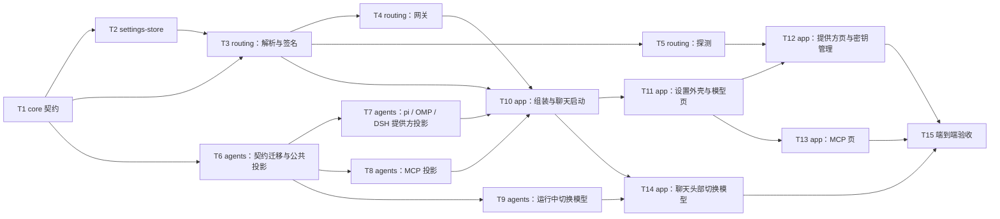

# 05 任务列表

供大模型逐个执行。每个任务自包含：读哪些章节、改哪些文件、做什么、怎么验收。顺序见 §2；同一层的任务可以并行。

## 1. 执行规则（每个任务都适用）

1. **先读**：[02 方案](02-plan.md) §1（用户决定 S01–S10）、[03 概要](03-architecture.md)、[04 详细](04-detail.md) 中任务列出的章节，以及任务涉及的现有代码。不要凭记忆改 trait。
2. **命令**：所有 cargo 命令经 `scripts\msvc\cargo-msvc.bat` 执行（直接跑 `cargo` 会用错链接器，见 `docs/BUILD.md`）。
3. **完成门槛**（每个任务结束都要跑，并在汇报里贴实际输出的结论行）：
   - `scripts\msvc\cargo-msvc.bat build --workspace`
   - `scripts\msvc\cargo-msvc.bat test --workspace`
   - `scripts\msvc\cargo-msvc.bat clippy --workspace --all-targets -- -D warnings`
   - 任务列出的额外验证（真实引擎或窗口）。
4. **规范**：库层只用 `thinkrail_core::Error`；非测试代码不用 `unwrap` / `expect`；不加 `#[allow]` 来过 lint；日志与错误消息不得含密钥、请求头值、环境变量值；依赖精确锁定（`=x.y.z`），在根 `Cargo.toml` 的 `[workspace.dependencies]` 声明后再引用。
5. **不做**：空实现、占位界面、mock 兜底、自动批准、超出任务范围的“顺手改进”。
6. **trait 有变动时**迁移所有调用者，删除被替代的旧代码，不留兼容层。
7. **测试**只用临时目录、占位密钥（如 `sk-test-a`）、本机回环上的假上游；真实中转只在标了“需用户同意”的步骤里使用，用 `#[ignore = "needs …"]` 隔离。
8. **收尾**：删除临时探针和脚本；更新本文件 §4 对应行的状态和证据；汇报改动的文件和实际运行的命令。

## 2. 依赖



可并行：T2 与 T6；T4、T5 与 T7、T8、T9；T12 与 T13。

## 3. 任务

### T1 core 契约

- **读**：04 §2 全部。
- **改**：`crates/core/src/{ids.rs, lib.rs, agent.rs, host_tools.rs}`；新建 `crates/core/src/{provider.rs, mcp.rs, routing.rs}`。
- **做**：
  1. `ids.rs` 增加 `ProviderId`、`ProviderKeyId`、`McpServerId`。
  2. 按 04 §2.2–2.5 定义全部类型和 `ProviderService`、`McpService`、`ModelPrefService`、`ModelRouter`、`ProviderProbe` 五个 trait；`lib.rs` 导出。
  3. `Secret` 手写 `Debug`（`Secret(***)`），不实现 `Display` / `Serialize`；含 `Secret` 的结构同样手写 `Debug`。
  4. `EngineRouting` 实现 `Default`（空路由），加 `pub fn is_empty(&self) -> bool`（providers、mcp、env 都为空，且没有 default_model）。
  5. 按 04 §2.6 修改 `StartSession`、`Capabilities`、`ModelInfo`、`AgentSession`；删掉 `HostToolAccess.support_dir`。
  6. 编译会在 agents、app 处失败——**本任务只改 core**，调用者迁移在 T6、T10 完成；为保证门槛能过，本任务同时做最小迁移：
     - 三个适配器的 `set_model` 先返回 `Err(Error::new(ErrorKind::BackendUnavailable, "该引擎暂不支持切换模型"))`，`Capabilities.model_switch = false`；T9 再实现并改为 true。
     - `StartSession` 的构造处填 `routing: EngineRouting::default()`、`support_dir` 用原来的 `<data>/engines`；T10 再改成真实值。
     - `ModelInfo` 新字段填 `None`。
- **验收**：完成门槛通过；`Secret` 的 `Debug` 输出不含值有单测；`EngineRouting::default().is_empty()` 为 true 有单测。

### T2 settings-store

- **读**：04 §1、§3；02 §2（M0 实测：外键每个连接都要开）。
- **改**：根 `Cargo.toml`（members 加 `crates/settings-store`；`[workspace.dependencies]` 加 `turso = { version = "=0.8.3", default-features = false }`、`pollster = "=1.0.1"`、`thinkrail-settings-store = { path = "crates/settings-store" }`）；新建 `crates/settings-store/` 全部文件（04 §3.1）。
- **做**：
  1. 先写一个最小测试确认 `turso::Database` 能否被多个线程共享（`Send + Sync` 编译检查 + 两个线程各开连接写入）；结论写进 04 §3.1 那条 `[INFERENCE]` 并去掉标记。
  2. 建表与迁移（04 §3.2）；版本更高时 `Corrupt` 且不改文件。
  3. 实现三个 trait；校验按 04 §3.3；掩码按 04 §2.2；轮询按 04 §3.4。
  4. 删除提供方时级联删除端点、模型、密钥、隐藏记录；删除模型时删除隐藏记录。
- **测试**（`src/tests.rs`，每条都是可观察行为）：
  - 提供方 CRUD；同名 `Conflict`；revision 过期 `Conflict`；`update` 保留密钥；删除级联。
  - 密钥：空值、重复被拒；掩码规则（长度 8 与 9 的边界）；`reveal_key` 返回原值。
  - 轮询：三个密钥依次轮换、回绕；停用中间一个后跳过；只剩一个时固定返回；`providers()` / `reveal_key` 不推进；删除游标指向的密钥后从第一个开始。
  - MCP：名称规则；全局与项目同名替换（`GlobalOverridden`）；项目覆盖启停；`set_override` 拒绝项目级条目；`effective` 顺序稳定。
  - 偏好：默认模型与力度读写；隐藏/取消隐藏；删除模型后隐藏记录消失。
  - 迁移：新库建表；重新打开数据不丢；手工把 `schema_meta.version` 改为 999 后打开报 `Corrupt` 且文件字节不变。
- **验收**：完成门槛通过。

### T3 routing：路由解析与签名

- **读**：04 §4。
- **改**：根 `Cargo.toml`（members 加 `crates/routing`；依赖按 04 §4.1 精确锁定，先只加本任务需要的 `sha2`、`serde_json`、`parking_lot`、`uuid`、`tracing`）；新建 `crates/routing/src/{lib.rs, router.rs, url.rs, signature.rs, tests.rs}`。
- **做**：
  1. `url::base_url` 与 `pub fn preview(raw, protocol) -> String`（04 §4.2，§7.6 的预览用）。
  2. `Router` 实现 `ModelRouter::prepare / signature / catalog / release`（04 §4.3–4.6）。网关相关的部分通过一个窄接口 `trait GatewayRoutes { fn base_url(&self, route: &str, protocol: Protocol) -> Result<String>; fn register(&self, chat: &ChatId) -> Secret; fn release(&self, chat: &ChatId); }` 依赖，T4 的 `Gateway` 实现它；本任务的测试用一个记录调用的测试替身。
  3. 测试用 `thinkrail-settings-store` 的真实实现（dev-dependency）+ 临时目录，不 mock 存储。
- **测试**：
  - 地址规范化：04 §4.2 列出的全部组合。
  - 空存储 → `EngineRouting::is_empty()`。
  - 一个提供方同时有 OpenAI 和 Anthropic 地址、模型分别声明不同协议 → 生成两个路由，模型各归其位；`route`、`key_var` 命名符合 04 §4.3。
  - 直连：两次 `prepare` 用到不同密钥（轮换）；`signature` 两次相同、且与 `prepare` 的签名相同；停用一个密钥后签名改变。
  - 有密钥但全部停用 → `Invalid`；没有任何密钥 → 占位值。
  - 网关：`base_url` 指向替身返回的地址；`env` 里的密钥是令牌而不是真实密钥；`release` 被转发。
  - 默认模型：只在 `new_session` 时给出；力度降到模型支持的最大档；默认模型被删除时为 None。
  - MCP：`$VAR` 解析成功与缺失报错；变量名由服务器 id 决定；`env` 不含未引用的变量。
  - DSH 且有额外请求头的直连提供方被改为网关。
  - `catalog` 过滤隐藏模型、去重。
- **验收**：完成门槛通过；`env` 以外的字段序列化后不含任何测试密钥字符串（加一条断言）。

### T4 routing：回环网关

- **读**：04 §5.1、§5.2；02 §4.2（M0 实测的依赖组合）。
- **改**：根 `Cargo.toml` 加 `tokio`、`hyper`、`hyper-util`、`http-body-util`、`bytes`、`futures-util`、`reqwest`、`rustls`（版本与特性完全照 04 §4.1）；`crates/routing/src/{runtime.rs, gateway.rs}`。
- **做**：
  1. `runtime.rs`：进程内唯一的 tokio 运行时 + 安装 ring 提供方 + 共用 `reqwest::Client`。
  2. `Gateway` 实现 T3 的 `GatewayRoutes`，按 04 §5.2 的 7 步处理请求。
- **测试**（本机回环假上游：同一测试里再起一个 hyper 服务记录收到的请求）：
  - 无令牌、错令牌 → 401；`release` 之后令牌失效。
  - 白名单外路径 → 404；未知路由 → 404。
  - 转发后上游收到的路径正确（OpenAI 类与 Anthropic 各一例，含地址带 `/v1` 和不带的情况）。
  - 上游收到的是真实密钥而不是令牌；引擎发来的 `authorization`、`x-api-key` 被替换；提供方额外请求头被加上；`anthropic-version` 被保留。
  - 两个密钥时上游依次收到不同密钥（按请求轮换）。
  - 上游分 3 块返回的响应被分块转发（客户端读到不止一块）。
  - 上游不可达 → 502，消息不含密钥。
  - 依赖树检查：`cargo tree -e normal -p thinkrail-routing` 中没有 `aws-lc`、`openssl`、`native-tls`（写成一条测试或在汇报中贴命令输出）。
- **验收**：完成门槛通过。

### T5 routing：探测

- **读**：04 §5.3。
- **改**：`crates/routing/src/probe.rs`。
- **做**：实现 `ProviderProbe`；错误分类和中文文案照 04 §5.3。
- **测试**（本机假上游）：OpenAI 形式与 Anthropic 形式的模型列表都能解析；Anthropic 请求带 `x-api-key` 与 `anthropic-version`；401 → “服务器拒绝了该 API 密钥。”；非 JSON → `Protocol`；空列表 → “服务器未返回任何模型。”；超时（假上游延迟超过超时）→ `Timeout`；`check_keys` 对每个启用密钥各请求一次、不推进轮换（之后 `next_key` 仍返回第一个）。
- **验收**：完成门槛通过。

### T6 agents：契约迁移与公共投影

- **读**：04 §2.6、§6.1；现有 `crates/agents/src/{process.rs, host.rs, pi.rs, omp.rs, dsh.rs}`。
- **改**：上述文件；新建 `crates/agents/src/projection_engine.rs`（含 `tests.rs`）。
- **做**：
  1. `LaunchSpec.host_env` 改为 `Vec<(String, OsString)>`，迁移所有调用者；`routing.env` 追加到 `host_env`（值用 `Secret::expose`）。
  2. `host::support_file` 改为写 `StartSession.support_dir`；宿主工具的扩展和 patch 改名为 04 §6.2、§6.4 的文件名。
  3. `projection_engine.rs` 放协议名映射、档位映射（pi `thinkingLevelMap`、DSH `reasoningEfforts`）等共用纯函数。
  4. `EngineRouting` 为空时三个适配器的启动参数与现在逐字一致。
- **测试**：空路由下三个引擎的 `host_args` 与改动前一致（对比固定的期望值）；`host_env` 含 `routing.env` 的所有变量；生成文件里不出现任何测试密钥字符串。
- **验收**：完成门槛通过；`smoke.rs` 里现有的三个 `#[ignore]` 握手测试在本机有引擎时仍能通过（命令见 `docs/BUILD.md`，结果写进汇报）。

### T7 agents：提供方与默认模型投影

- **读**：04 §6.2–6.4 中提供方和默认模型部分；01 §3.1–3.2。
- **改**：`pi.rs`、`omp.rs`、`dsh.rs`、`projection_engine.rs`。
- **做**：
  1. pi：生成 `pi-thinkrail.js`（宿主工具 + `registerProvider`）；新会话加 `--model`、`--thinking`。
  2. OMP：生成 `omp-thinkrail.ts`（`registerProvider`，TypeScript 最小接口，不用 `any`）与 `omp-thinkrail.yml`（`modelRoles.default`、`mcp.enableProjectConfig: false`）；加 `-e`、`--config`。
  3. DSH：生成 `dsh-thinkrail.patch.yml`（`tool-todo`、`llm-pi-ai.providers`、`acp`）。
  4. 生成函数都是纯函数，单测用快照（期望字符串写在测试里）。
- **实测并回写 04**（需用户同意使用真实中转；用隔离的空配置目录）：
  - 三个引擎各自只靠投影（配置目录里没有任何模型配置）能用 easyclaude 回复一轮；发送一张 PNG 能描述图片内容。
  - DSH：用户自己 `cordis.patch.yml` 里的路由在加了宿主 patch 后是否仍可用（04 §6.4 的 `[INFERENCE]`）；DSH `headers` 是否支持环境变量引用。
  - 用户参数与宿主参数冲突时哪个生效（04 §6.1 的 `[INFERENCE]`）。
  - 把结论写回 04 对应位置并去掉 `[INFERENCE]`；结论推翻设计时按 04 中写好的备选做法实现。
- **验收**：完成门槛通过 + 上述实测记录。

### T8 agents：MCP 投影

- **读**：04 §6.2–6.4 中 MCP 部分；02 §5。
- **改**：`pi.rs`、`dsh.rs`、新建 `crates/agents/src/omp_mcp.rs`（含测试）。
- **做**：pi 在扩展里 `registerMcpServer`（值读 `process.env`）；DSH 追加到 `mcpServers`（值从 `routing.env` 取）；OMP 合并写配置目录的 `mcp.json`（04 §6.3 的 5 条规则）。
- **测试**：`omp_mcp` 合并保留用户条目和未知顶层字段、删除过期的 `thinkrail-` 条目、无变化不写文件、非法 JSON 不改文件并报 `Invalid`、写入的值是 `${VAR}` 不是明文；DSH 的 `session/new` 参数包含投影条目（对生成的 JSON 断言）。
- **实测**（本机 stdio echo MCP 服务器，与 M0 相同的做法，返回不可猜测的标记）：三个引擎都能调用它并复述标记。
- **验收**：完成门槛通过 + 实测记录。

### T9 agents：运行中切换模型

- **读**：04 §2.6、§6.2–6.5。
- **改**：`pi.rs`、`omp.rs`、`dsh.rs`、`rpc.rs`。
- **做**：实现 `AgentSession::set_model`；`Capabilities.model_switch = true`；`ModelInfo.effort` 按 04 §6.5 读取并在变化时发布快照。会话不空闲时 `set_model` 返回 `SessionBusy`（用现有 `ensure_idle`）。
- **测试**：发出的帧格式（pi/OMP 的 `set_model` + `set_thinking_level`；DSH 的两次 `set_config_option`）用现有协议测试的方式断言。
- **实测**：三个引擎各切换一次模型，下一轮回复来自新模型（`SessionSnapshot.model` 变化 + 引擎会话记录）。
- **验收**：完成门槛通过 + 实测记录。

### T10 app：组装与聊天启动

- **读**：03 §5.1、§5.3；04 §7.1–7.3。
- **改**：`crates/app/Cargo.toml`（加 `thinkrail-settings-store`、`thinkrail-routing`）、`main.rs`、`services.rs`、`state.rs`、`panels/chat.rs`。
- **做**：
  1. `Args.db_path` 与默认位置（04 §7.1）；数据库目录不可写时启动报错并提示 `--data-dir`。
  2. `Services` 新增 5 个字段与 `support_dir(chat)`；`build` 组装。
  3. `start_engine` 调 `router.prepare`、填 `routing` 与 `support_dir`；`close_chat` 调 `router.release` 并删除 `support_dir`。
  4. `AppEvent::RoutingChanged` 与“签名变化后空闲重启 / 运行中延后重启”（03 §5.3）。
- **测试**：`db_path` 的推导（给 / 不给 `--data-dir`）；签名比较决定是否重启的逻辑抽成纯函数后单测。
- **窗口验证**：用 `--data-dir` 指向临时目录启动；数据库文件出现在 `<data-dir>/thinkrail.db`；没有提供方时新建聊天行为与之前一致（回归）。
- **验收**：完成门槛通过 + 窗口截图。

### T11 app：设置外壳与模型页

- **读**：01 §1.1–1.3；04 §7.4、§7.5、§7.9。
- **改**：把 `panels/settings.rs` 拆成 `panels/settings/` 目录（04 §7.4）；现有档案页原样迁入 `agents.rs`（含其单元测试）；新建 `layout.rs`、`models.rs`；`strings/settings_models.rs`；`ui` 的 `icon_assets!` 补缺的图标。
- **做**：左侧导航 + 内容区；模型页的会话模型、力度、可见模型。写库成功后发 `RoutingChanged`。
- **窗口验证**：打开设置，四个导航项可切换；模型页选择默认模型与力度后重开对话框仍保持；隐藏一个模型后计数文案变化；截图与原版截图（01 引用的原版设置页）并排对比布局与配色。
- **验收**：完成门槛通过 + 截图。

### T12 app：模型服务页与密钥管理

- **读**：04 §2.2、§2.5、§3.3、§5.3、§7.6、§7.7；Aether `packages/ui/src/providers/`（布局与交互参考）。
- **改**：`crates/app/src/panels/settings/providers/{mod,rail,detail,models,dialogs,keys}.rs`、`strings/settings_providers.rs`；纯规则放在 `core::{provider_edit, model_catalog, preset}`。
- **设计**：按 04 §7.6 做两栏布局，改动立即保存，保存失败保留 draft 并可重试；同步模型先挑选、确定后用 `merge_picked` 合并，取消不改任何东西；模型设置编辑副本，确定后替换。
- **测试**：合并、线路、能力推断规则在 `crates/core/tests/`；预设种子和删除保护在 `crates/settings-store/tests/presets.rs`；按密钥检测（不轮换、失败不带密钥值、缺线路被拒）在 `crates/routing/src/tests.rs`。
- **状态**：🟡。2026-11-01：`cargo test --workspace` 全部通过；clippy 未运行（工具链 1.99.1 没有安装 `cargo-clippy`）。真实窗口验证用隔离 `--data-dir`、本机假上游 `127.0.0.1:18765`，没有接真实中转，依次操作了：
  - 打开设置，看到三个内置预设。
  - 新建“Local”服务商；首次在密码框回车添加密钥后，状态点由黄转绿。
  - 检测显示“连接正常 · 可用 6 个模型”。
  - 同步模型（改版后，13 个模型的假上游）：类型页签依次为“全部 13、对话 6、图像 3、视频 1、语音合成 1、语音识别 1、向量 1、重排 0、未知 0”；grok-2-vision、gpt 两个对话模型标“可看图”。点 + 添加 grok-2 和 gpt-image-2 后，“已选 2 个”立即更新，日志写入 revision 3 和 4；切到“图像”页签只剩 3 个图像模型。关闭对话框后，列表里 gpt-image-2 带“图像”标签。
  - 模型设置：开启推理但不选档位时提示“开启推理时至少选择一个档位”；选“高”保存后，行上出现推理图标，日志写入 revision 4。
  - 密钥管理：添加第二把错误密钥后页脚为“2 / 2 已启用”；检测逐条显示一通过一失败，错误里没有密钥值；在结果行停用失败的密钥后，“+1”消失。
  - 添加 Anthropic 线路：请求地址预览为 `POST …/v1/messages`，出现线路选择器，新线路下显示“未选择模型”。
  - 发现并修复两个问题：在密码框按回车会关闭设置对话框；同步模型时在更新中读取页面导致 panic。
- **未验证**：剪贴板复制内容、删除服务商、删除线路、改名、切换接入方式没有在窗口里操作；也没有接真实中转。

### T16 app：编码搭档页（安装与每个引擎的服务商）

- **读**：04 §7.10；Cherry Studio `src/renderer/pages/code/`。
- **改**：`core::engine_setup`、`ModelPrefs.engine_providers` / `set_engine_provider`、`agents::install::ManagedEngines`、`routing::router::plan`、`panels/settings/coding.rs`、`strings/settings_coding.rs`。
- **状态**：🟡。2026-11-01：
  - `cargo test --workspace` 全部通过，新增 `engine_choice_picks_gateway_official_or_one_provider`，覆盖统一网关强制走网关、官方不投影、单个服务商保留直连、其他引擎不受影响、服务商删除后报 `Invalid`。
  - `install::tests::installs_all_engines`（忽略的联网测试）在临时目录里装完三个引擎，用时 144 秒，`--version` 依次输出 `1.4.0`、`omp/18.14.2`、`0.2.1-rc.5`。
  - 真实窗口（隔离 `--data-dir`）：
    - OMP 在 `PATH` 上找到，路径 `…\.bun\bin\omp.exe`，显示“系统”。
    - Pi 显示“未安装”；点“安装”后显示“安装中…”和提示，装完显示“内置 · 版本 1.4.0”。
    - “设为默认”生成档案“Pi（编码搭档）”，并设为默认。
    - “Pi 官方”点“启用”后显示“已启用”，底部链接跳到模型服务页。
  - 用这次托管安装的 node 和 pi 跑 `smoke::pi_rpc_handshake`，通过。
- **未验证**：
  - 窗口里的 OMP、DSH 托管安装，以及它们在聊天里的真实对话（OMP 18.14.2 的握手也还没在聊天里复测）。
  - 安装失败时的显示和“重试”。
  - 统一网关、单个服务商在真实中转上的对话。

### T13 app：MCP 页

- **读**：01 §1.5；02 §5；04 §7.8。
- **改**：`panels/settings/mcp.rs`、`strings/settings_mcp.rs`。
- **做**：全局 / 当前项目两个视图、增删改、启停、项目覆盖、预设、粘贴 JSON 导入。
- **窗口验证**：添加一个全局 stdio 服务器；在项目视图里停用它，回到全局视图它仍启用；添加同名项目级服务器后全局条目显示“已被同名项目条目替换”；粘贴含 2 个服务器（1 个合法 1 个名称非法）的 JSON 只导入合法的。
- **验收**：完成门槛通过 + 截图。

### T14 app：聊天头部切换模型

- **读**：03 §5.4；04 §7.2 最后一条。
- **改**：`panels/chat.rs`、`strings/chat.rs`。
- **做**：模型名改为下拉 + 力度下拉；调用 `set_model`；不支持或无活动会话时只读。
- **窗口验证**（需用户同意）：三个引擎各在一个聊天里切换模型后发一条消息，头部和回复都反映新模型。
- **验收**：完成门槛通过 + 截图。

### T15 端到端验收

- **读**：04 §8；本文件 §4。
- **做**（需用户同意使用真实中转；隔离的空引擎配置目录）：
  1. 只在设置里配置 easyclaude（不改任何引擎配置文件），pi、OMP、DSH 各新建一个聊天，直连方式回复一轮、识别一张图片、调用用户配置的 MCP 工具。
  2. 把提供方改为网关方式，三个引擎正在运行的聊天在空闲后自动重启，再各回复一轮；网关日志显示两个密钥交替使用。
  3. 停用全部密钥，新建聊天时显示“没有启用的 API 密钥”的错误，不启动引擎。
  4. 删除提供方，已有聊天保留历史；头部显示模型不可用或引擎报错，不自动换模型。
  5. 检查 `<data>/logs`、`support_dir` 下的生成文件、OMP 的 `mcp.json`：都不含密钥明文（用占位方式检索，不打印密钥）。
- **验收**：§4 每一行都有证据；更新 02 §7 里程碑状态和 `docs/BUILD.md`（如有新命令）。

## 4. 验收矩阵

状态：✅ 已有实测证据 · 🟡 部分完成 · ⬜ 未开始。

| 编号 | 验收项 | 任务 | 状态 | 证据 |
|---|---|---|---|---|
| A01 | 设置数据存在 `<exe>/data/thinkrail.db`（或 `<data-dir>/thinkrail.db`），Turso 正式版 | T2、T10 | 🟡 | 存储侧测试与 `main.rs` 路径测试通过；原生窗口以临时 `--data-dir` 启动成功，数据库路径逻辑覆盖 `.autorail` 默认目录和显式目录。启动数据库失败时提示检查可写目录或使用 `--data-dir`。完整文件创建检查仍待独立保留证据。 |
| A02 | 提供方全局一份，所有档案共用 | T3、T15 | 🟡 | 路由侧（T3）：`thinkrail-routing::Router` 只读全局 `ProviderService`，`RouteRequest` 不含档案；三个引擎同一份配置（测试 `dsh_with_extra_headers_switches_a_direct_provider_to_the_gateway` 对 pi / DSH 用同一存储）。待 T15 实测 |
| A03 | 一个提供方可同时配 OpenAI 与 Claude 地址，模型按端点类型路由 | T3、T7 | 🟡 | 路由测试 `one_provider_with_two_protocols_projects_two_routes`、`base_url_normalization_matrix` 通过；三引擎实际加载投影并按路由切换成功（`smoke::{pi,omp,dsh}_loads_the_projected_provider_default_model_and_mcp_server`）。未发送真实中转请求 |
| A04 | 多密钥轮换：直连每次启动轮换，网关每个请求轮换 | T2、T3、T4、T15 | 🟡 | 轮询（T2）：`next_key` 按 04 §3.4；测试 `round_robin_rotation`、`deleting_the_cursor_key_restarts_from_the_first`。直连（T3）：`direct_rotation_keeps_the_signature_until_keys_change`（两次 `prepare` 用到 `sk-test-a`、`sk-test-b`；`signature` 不推进且与 `prepare` 一致；停用一个密钥后签名改变）。网关（T4）：`gateway_rotates_keys_per_request`（三个请求上游依次收到 a、b、a）。探测不推进（T5）：`check_keys_checks_each_enabled_key_without_rotating`。待 T15 真实中转 |
| A05 | 密钥掩码回显、显示、复制、编辑、删除、启停、检测所有密钥 | T12 | 🟡 | `providers.rs` 已实现全部操作；Cherry 风格提供方页已通过 `cargo check`、app 单测和 clippy，真实窗口启动验证完成。密钥明文显示/复制/检测流程未使用真实凭据，仍待授权验收。 |
| A06 | 视觉模型能识别图片（三个引擎） | T7、T15 | ⬜ | |
| A07 | 直连方式三个引擎都能用中转回复 | T7、T15 | 🟡 | 三个真实引擎连接本机 SSE 上游完成一轮并得到准确助手回复。真实中转未调用 |
| A08 | 网关方式三个引擎都能用中转回复；无令牌请求 401 | T4、T15 | 🟡 | 网关（T4，本机 hyper 假上游）：`gateway_rejects_missing_wrong_and_released_tokens`（无令牌、错令牌、被替换的令牌、`release` 后均 401）；`gateway_404s_outside_the_whitelist_and_for_unknown_routes`；`gateway_forwards_paths_keys_and_headers`（OpenAI / Anthropic 地址带与不带 `/v1` 时上游路径正确；上游收到真实密钥而非令牌，提供方请求头加上，`anthropic-version` / `anthropic-beta` 保留）；`gateway_streams_chunks_and_reports_unreachable_upstreams`（3 块分块转发、不可达 502 且不含密钥）。依赖树 `cargo tree -e normal -p thinkrail-routing` 无 `aws-lc` / `openssl` / `native-tls`（ring 0.17.14 + rustls 0.23.46）。待 T15 三个引擎实测 |
| A09 | MCP 全局 + 项目覆盖，三个引擎都能调用 | T2、T8、T13、T15 | 🟡 | 存储覆盖规则测试通过；pi/OMP/DSH 真实进程启动临时 echo MCP，收到注入值并执行 tools/list；DSH 命令按 PATH 解析为绝对路径。未用真实模型选择并调用 MCP 工具，UI 覆盖待验 |
| A10 | 默认模型与力度对新聊天生效；运行中可切换模型 | T7、T9、T11、T14 | 🟡 | pi/OMP/DSH 投影启动与协议切换测试通过；新增 `chat.rs` routing 状态单测覆盖 unchanged、idle restart、running pending；设置对话框已在临时无提供方窗口打开。真实中转后的下一轮回复和完整设置页交互仍未验。 |
| A11 | 配置变化后空闲重启，运行中延后 | T10、T15 | 🟡 | `chat.rs` 的 `routing_action` 单测覆盖 unchanged、idle restart、running pending 三种状态；真实引擎端到端重启尚未验证。 |
| A12 | 没有配置提供方时行为与之前完全一致 | T6、T10 | 🟡 | 三引擎空路由回归与 app 无提供方单元测试通过；临时数据目录原生窗口启动成功并显示无项目/无模型状态。新建聊天的无默认 Agent 档案交互仍待窗口操作证据。 |
| A13 | 日志、生成文件、错误消息不含密钥 | T3、T6、T15 | 🟡 | T6：`routing.env` 只经 `Secret::expose` 进子进程环境（`process::routing_env`），`{pi,omp,dsh}::tests::routing_env_*` 断言 `host_env` 含全部变量、`support_dir` 下生成文件不含 `sk-test-a/b/c`；`process::tests::routing_env_is_applied_last_and_wins_over_profile_variables`。T3：所有路由测试经 `assert_no_secret_outside_env` 断言 `env` 以外字段的序列化与 `Debug` 不含测试密钥、请求头值、MCP 值；签名只对请求头与 MCP 值取 SHA-256。T4/T5：网关 502 与探测错误消息不含密钥（`probe_classifies_failures` 上游回显密钥时被替换为 `***`）。T15 待做 |
| A14 | 界面对标原版（导航、分组、行布局、配色） | T11–T13 | 🟡 | 已直接分析 Cherry Studio `ProviderList`、`ProviderSetting`、`ModelListHeader` 与 AutoNote/Aether 的 `/models` 探测契约；原生提供方页保留多端点数据但只显示当前协议对应的 API 地址，协议切换与地址配对，模型主操作为“同步模型”，手动添加为次要入口。24 项 app 单测、workspace clippy 和构建通过；严格并排截图仍未完成。 |

2026-10-31 后端联调：pi 3 项、OMP 4 项、DSH 2 项真实进程 smoke 通过（隔离配置、占位模型、不发 prompt）。DSH 实测推翻深合并假设，现合并 profile/home 用户路由且保留 `!!js`，用户文件不变；生成文件仅引用合并环境变量。新增回归覆盖同 id 密钥编辑触发签名变化、全部密钥停用后网关拒绝上游、探测错误脱敏请求头值。

本机链路验证：一次性探针使用临时 Turso 存储与回环 SSE 上游，pi / OMP / DSH 分别在直连、网关下启动并发送一轮（六组合）。每项断言助手消息精确为 `LOCAL_SETTINGS_SMOKE_OK` 且回到 Idle，通过；探针及其 dev-dependency 已删除。不是实时供应商/视觉验证。

## 5. 已知限制（本期接受）

- 多个聊天共用同一个 OMP 配置目录且属于不同项目时，OMP 的 `mcp.json` 只能反映最后启动的那个项目的 MCP 集合（04 §6.3 第 5 条）。
- DSH 下有额外请求头的提供方强制走网关（04 §6.4），直到实测证明 DSH 支持请求头的环境变量引用。
- 本期不做：跨协议转换、OAuth 订阅登录、评审模型、MCP 运行状态与工具数（02 §8）。

## 6. 交接提示模板

```text
任务：实施 docs/design/agent-settings/05-tasks.md 中的 Txx。
先读 05 §1 执行规则，再读 Txx 的“读”列出的章节和涉及的现有代码。
- 只改 Txx“改”列出的文件；trait 有变动时迁移所有调用者，删除被替代的旧代码。
- 所有 cargo 命令经 scripts\msvc\cargo-msvc.bat 执行。
- 测试只用临时目录、占位密钥和本机假上游；标了“需用户同意”的步骤先征得同意再用真实中转。
- 日志、错误、生成文件、汇报中都不得出现密钥明文。
完成后：跑完成门槛的三条命令和 Txx 的额外验证，更新 05 §4 对应行，汇报改动文件和实际运行的命令及结果。
```
