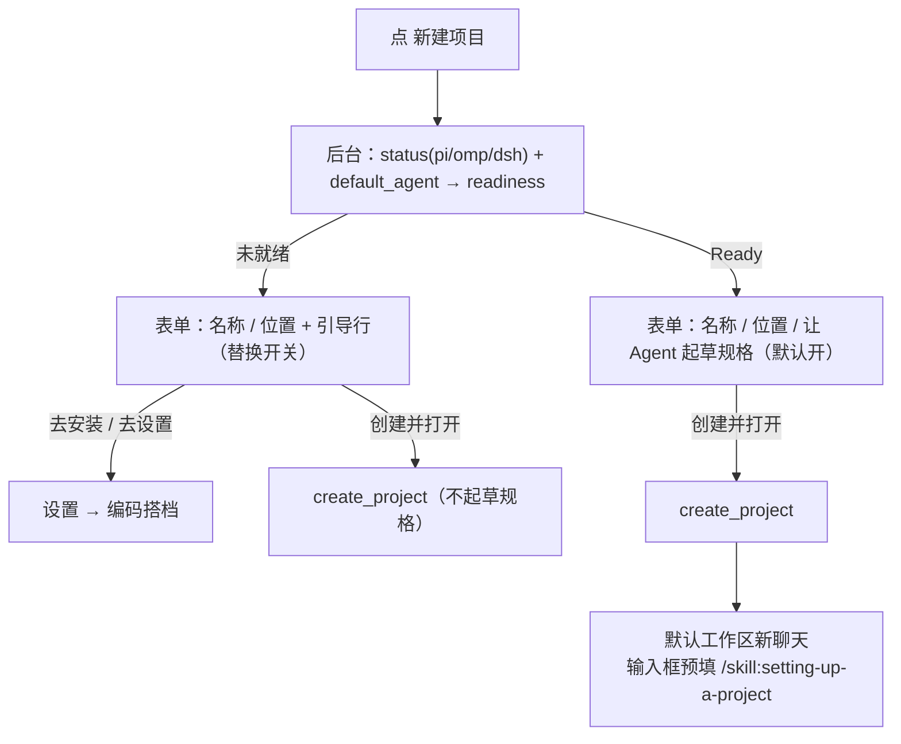
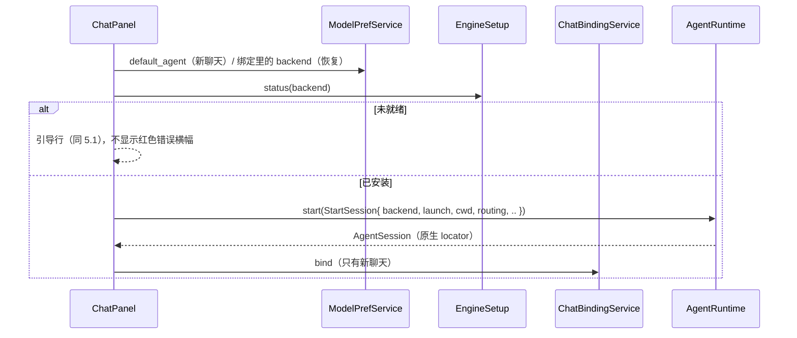

# 07 概要设计：默认 Agent 与新建项目引导

状态：**已实现**（2026-11-01，A1–A5）。本文取代 Agent 档案：`ProfileService`、`agent-profiles.json`、“设置 → Agent 档案”页，以及 U06 中“在 Agent 档案里填可执行文件”。沿用 [03 概要设计](03-architecture.md) 的分层和多 Agent 设计包的错误、日志规范。

## 1. 现状问题

- **默认 Agent 有两个入口。** “Agent 档案”页可以设默认；“编码搭档”的“设为默认”会在后台另建一个档案“{名称}（编码搭档）”再设默认（04 §7.10）。两处互相覆盖，用户分不清以哪个为准。
- **配置分两处存。** 提供方、模型、MCP、编码搭档的服务商选择在 `thinkrail.db`；档案、默认档案、聊天绑定在 `agent-profiles.json`。
- **新建项目后才报错。** 打开“让 Agent 起草规格”的开关创建项目后，如果没有默认档案，聊天顶部显示红色横幅 `NOT_FOUND`：“还没有默认 Agent 档案。请先在设置中新建档案并设为默认。”。这条提示把用户引到已经被编码搭档取代的档案页，而且此时项目已经建好了。
- **检测和安装只在设置里。** 用户第一次用时，不知道要先去编码搭档装引擎。

## 2. 决定

| 编号 | 决定 |
|---|---|
| D1 | 去掉 Agent 档案。引擎只来自编码搭档：托管安装，或 `PATH` 上检测到的 pi / omp / dsh（`EngineSetup::status`）。不再支持手填可执行文件、启动参数、配置目录和环境变量引用。 |
| D2 | 默认 Agent 存成一个 `BackendKind`，放在 `thinkrail.db` 的 `model_prefs` 里，键为 `default_agent`。只有编码搭档的“设为默认”写它。 |
| D3 | 聊天绑定改存到 `thinkrail.db` 的新表 `chat_bindings`。绑定只记后端和原生会话，不记启动路径；每次启动都按当时的检测结果找引擎。 |
| D4 | 引擎使用自己的默认配置目录：pi `~/.pi/agent`，OMP `~/.omp/agent`，DSH `~/.dsh`。宿主仍只写每个聊天的辅助目录。OMP 的 `mcp.json` 照旧只增删 `thinkrail-` 开头的条目（04 §6.3）。 |
| D5 | 新建项目时检查引擎和默认 Agent：一个引擎都没装，就引导去安装；装了但没有设默认（或默认的引擎已找不到），就引导去设为默认。新建聊天遇到同样情况，给出同样的引导。 |
| D6 | 不迁移旧数据。这是新项目，`agent-profiles.json` 不再读取。数据库表结构只描述当前版本，不写升级步骤。 |

## 3. 状态归属（变化部分）

| 状态 | 权威所有者 | 说明 |
|---|---|---|
| 默认 Agent | `ModelPrefService`（`model_prefs.default_agent`） | 只影响新聊天 |
| 聊天绑定 | `ChatBindingService`（新 trait，`settings-store` 实现，表 `chat_bindings`） | 聊天创建时绑定后端，之后不再改 |
| 引擎安装 | `EngineSetup`（检测结果，不持久化） | 托管安装在 `<data>/coding/`，系统安装在 `PATH` |
| 引擎凭据、原生配置 | 引擎默认配置目录 | 宿主不读也不写，只合并 OMP `mcp.json` 中的 `thinkrail-` 条目 |
| ~~档案、默认档案、档案版本~~ | 删除 | — |

## 4. 表结构

```sql
CREATE TABLE chat_bindings (
    chat_id TEXT PRIMARY KEY,
    workspace_id TEXT NOT NULL,
    backend TEXT NOT NULL,               -- 'pi' | 'omp' | 'dsh'
    native_session_key TEXT NOT NULL,
    created_at INTEGER NOT NULL          -- 标签顺序
);
```

- 默认 Agent 是单个值，沿用现有键值表：`model_prefs(key = 'default_agent', value = '"pi"')`，不另建表。
- `ChatBindingService`：`bind(binding)`、`bindings(workspace)`（按 `created_at` 排序）、`unbind(chat)`。语义与原 `ProfileService` 中的这三个方法相同：解绑不存在的绑定也算成功，绑定失败时释放刚启动的引擎。
- `ChatBinding` 改为 `{ chat_id, workspace_id, backend, native_session_key }`，删掉 `profile_id` 和 `config_revision`。

## 5. 核心流程

### 5.1 就绪判断

`core::engine_setup::readiness(default, installed) -> Readiness` 是纯函数，界面和聊天都用它：

| 结果 | 条件 | 引导文案（设计） | 按钮 |
|---|---|---|---|
| `Ready(backend)` | 已设默认，且该引擎已安装 | — | — |
| `NoneInstalled` | 三个引擎都没装 | 还没有安装 Agent。装好一个后，就能让 Agent 起草规格。 | 去安装 |
| `NoDefault` | 有已安装的引擎，但没有设默认 | 已安装 {名称}，还没有设为默认 Agent。 | 去设置 |
| `DefaultMissing(backend)` | 默认的引擎已找不到（例如被卸载） | 默认 Agent {名称} 未找到，请重新安装或换一个。 | 去编码搭档 |

按钮关闭当前对话框，打开“设置 → 编码搭档”，并选中相关引擎：`NoneInstalled` 选 Pi，`DefaultMissing` 选原默认引擎，`NoDefault` 选第一个已安装的引擎。

### 5.2 新建项目



- 检查在对话框打开时于后台执行，不联网；结果出来之前，开关行显示为禁用。
- 未就绪时项目照样能建：文件、终端、Git 都不需要 Agent。只是不起草规格，引导行说明原因。
- 预填的写法按默认引擎决定：pi 和 OMP 用 `/skill:<name>`，DSH 用 `/<name>`（已实现，见 `agents::skill_command`）。

### 5.3 新建聊天与恢复



- `StartSession` 用 `backend` 和 `launch` 替换 `profile`；`process` 不再注入 `config_root` 和 `env_refs`。
- 已绑定的聊天如果引擎找不到：保留历史，只读，引导去编码搭档；不会自动换成其他后端（沿用多 Agent 设计包的原则）。
- 改默认 Agent 只影响新聊天，不发重启事件。

### 5.4 编码搭档页

- “设为默认”只写 `default_agent`，不再创建档案。“默认”徽标根据 `default_agent` 显示。
- 打开时可以带上要选中的引擎（供 5.1 的按钮使用）。

### 5.5 默认配置目录

- pi、OMP：不再设置 `PI_CODING_AGENT_DIR`，引擎自己决定配置目录。OMP 的 MCP 合并写到 `~/.omp/agent/mcp.json`；`omp_mcp::sync` 现在没有配置目录时报 `Invalid`，这条报错删除。
- DSH：`dsh_home` 现在已经在没有配置目录时退回 `~/.dsh`。目录不存在时会报 `BackendUnavailable`，改为启动前自动创建（托管安装不会创建这个目录）。
- 继承来的 `PI_*` / `OMP_*` / `DSH_*` 变量照旧剔除（`process::is_isolated`），引擎读到的总是默认目录。

## 6. 删除清单（一次切换，不留兼容层）

| 位置 | 删除 / 改动 |
|---|---|
| `crates/profiles` | 整个 crate（`JsonProfileStore`、`agent-profiles.json`、锁文件） |
| `core::profile` | 删除 `Profile`、`ProfileInput`、`ProfileCatalog`、`EnvRef`、`EnvSource`、`ProfileService`、`ProfileId`；`BackendKind`、`Launch` 移到 `engine_setup`；`ChatBinding` 按 §4 改 |
| `core::error` | 删除 `ErrorKind::ProfileDisabled` |
| `agents` | `LaunchSpec` 去掉档案、配置目录变量和 `env_refs`；`reject_args`（拦截用户参数中的保留标志）随手填参数一起删除；OMP 的 MCP 合并写到默认配置目录；测试夹具 `testing::Fixture` 改用 `backend` + `launch` |
| `app` | 删除 `panels/settings/agents.rs`（447 行）和导航项 `Page::Agents`；删除 `strings/settings.rs` 中的档案文案和 `chat::NO_PROFILE` / `PROFILE_MISSING`；`coding.rs` 的 `set_default` 改写；`chat.rs` 的 `start_engine` 按 5.3 改；`open_project.rs` 加就绪检查 |
| 文档 | 多 Agent 设计包 03 §3–§4、04 §7–§8 中与档案有关的内容；本包 03 §4、04 §7.4 / §7.10；`SPEC.md` 模块表中的 `profiles` |

## 7. 验证

- **单元测试**（各 crate 的 `tests/`）：
  - `readiness` 四种结果的边界（默认的引擎已装或未装、其他引擎已装）；
  - `chat_bindings` 的 `bind`、按工作区列出时的顺序、重复 `unbind`；
  - `default_agent` 写入后能读回，清除后为空。
- **窗口验证**（临时 `--data-dir`，`PATH` 中去掉 pi / omp / dsh）：
  1. 新建项目，看到 `NoneInstalled` 引导，“去安装”打开编码搭档并选中 Pi；
  2. 安装 Pi 后不设默认，再新建项目，看到 `NoDefault` 引导；
  3. 设为默认后再新建项目，开关可用，创建后新聊天的输入框为 `/skill:setting-up-a-project `；
  4. 新建聊天时不出现 `NOT_FOUND` 红色横幅。
- **引擎冒烟**：`smoke::*` 改用新的 `StartSession` 后重跑，其中包括已有的三引擎 `*_expands_the_bundled_setup_skill`。

## 8. 任务拆分

| 任务 | 内容 | 依赖 |
|---|---|---|
| A1 | `core`：`Readiness` / `readiness`、`ChatBinding`、`ChatBindingService`、`StartSession`；删除档案类型 | — |
| A2 | `settings-store`：`chat_bindings` 表、`ChatBindingService` 实现、`default_agent` 读写 | A1 |
| A3 | `agents`：`LaunchSpec` 与三个引擎改用 `backend` + `launch`；OMP `mcp.json` 写到默认目录；测试和冒烟迁移 | A1 |
| A4 | `app`：`services` 去掉档案存储；`chat.rs` 按 5.3 改；编码搭档“设为默认”；删除档案页；新建项目对话框的就绪检查和引导 | A2、A3 |
| A5 | 删除 `crates/profiles`；按 §6 更新文档；窗口验证 | A4 |
