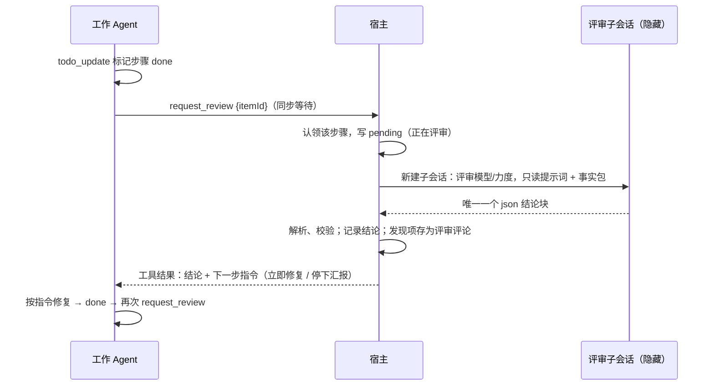

# 08 模型页对标原版：默认模型、可见模型、评审、GPT 上下文窗口

状态：**第一期已实现**（2026-11-07，R1、R2：默认模型组布局、不可用提示、模型来源、GPT 上下文窗口）；第二期评审待实施。补齐 [02 方案](02-plan.md) §模型页中“本期不做”的评审组和 GPT 上下文窗口，并把现有默认模型组改成原版的行布局。沿用 [03 概要设计](03-architecture.md) 的分层，以及多 Agent 设计包的错误、日志、事实标记规范。标 `[推断]` 的内容没有读到代码或运行验证。

已定（2026-11-07，用户）：先做默认模型组布局和 GPT 上下文窗口，评审后做；评审者可以运行 shell；pi/OMP 同步回传、DSH 异步；上下文窗口用独立覆盖值，不改提供方设置；固定评审模型不可用时报错，密钥失败才换密钥重试；不可用文案按实际行为写；模型从中转取、按引擎提示；改动集完整对标原版，宿主在步骤完成时替 Agent 提交。

## 1. 原版（`E:\workspace\notepad-dev\thinkrail`）

Web 端在 `apps/web/src`，宿主在 `packages/server/src`，共享类型在 `packages/contracts/src`。

### 1.1 布局

- 页面 `panels/ModelsSettings.tsx`，三个分组。分组之间有上边框和 24px 间距（`SettingsGroup.tsx:26-40`）；组标题是 pill 样式的 `h3`。
- 行 `SettingsRow.tsx:15-41`：左侧标签和可选说明，右侧控件，`py-12`，下边框；组内最后一行没有下边框。
- 开关 `SettingsSwitch.tsx`：36×20，`role=switch`。

### 1.2 默认模型组

| 行 | 控件 | 行为 |
|---|---|---|
| 会话模型 | `ModelSelector`（最大宽 220）+ `ThinkingSelector`（“力度 {档位}”） | 选模型写 `settings.update {defaultModel}`，再读 `model.default`；保存或读取中两者都禁用。没有“清除默认”入口 |
| 可见模型 | 整行是按钮，右侧箭头；说明“新模型会自动显示。”或“已隐藏 N 个模型。新模型会自动显示。” | 在本页原地展开，不是子页面：搜索框 + 最高 320 的滚动列表，每个模型一行带开关 |

- 模型下拉（`chat/ModelSelector.tsx`）：340 宽浮层，搜索、“已固定”组、按提供方折叠分组（只展开当前模型所在组），每行“名称 / {上下文} 上下文 · 推理 / id”，底部“刷新”。
- 力度选项是模型的 `thinkingLevels`；为空时禁用。显示的档位 = 宿主解析值 → `defaultEffort` → `medium`，宿主按模型裁剪（`agentSessionManager.ts:2814-2820`）。换模型不改写 `defaultEffort`，读取时再裁剪。
- 新会话默认模型解析（`host/newChatModel.ts:23-50`）：请求指定 → 可用的 `defaultModel` → pi 自己的默认 → 各提供方默认或第一个模型。
- 可见模型只存隐藏项（`chat/modelVisibility.ts`，客户端本地），所以新模型自动出现。过滤 `selectPickerModels`（`store/selectors.ts:1252-1262`）总是保留调用方当前选中的模型：聊天输入框、会话模型行、评审模型行都用它。

### 1.3 评审组

见 §3，单独展开。

### 1.4 GPT 上下文窗口组

`panels/ModelContextSettings.tsx`、宿主 `agent/modelContext.ts`。

- 资格：模型可用，协议是 `openai-responses` 或 `openai-codex-responses`，且已有覆盖值或有效上下文正好是 272 000（`modelContext.ts:29-48`）。没有符合的模型时，“全局”一行右侧显示“没有符合条件的模型”（截图就是这个状态）。
- 有符合的模型时：
  - “全局”是三段单选：默认（删除覆盖）/ `1M` / 自定义（输入 272 000–1 000 000，回车或失焦保存，Esc 还原）。说明“N 个可用模型”，覆盖值不一致时显示“按模型分别设置”。
  - 下方说明框，再下面是可折叠的“按模型分别设置”，每个模型一个同样的控件，说明“{提供方} · {N} token（pi 默认）”。
- 存储：pi 的 `models.json` 中 `providers.<provider>.modelOverrides.<id>.contextWindow`；按 JSONC 编辑，保留注释和 BOM。只对新会话生效。
- 用途 `[推断]`：GPT 的 Responses 模型默认按 272K 上下文使用，可以按需放到 1M。

## 2. 原生版现状

### 2.1 已有

- 设置外壳 `crates/app/src/panels/settings/mod.rs`：`enum Page`、每页一个 `Entity`、左侧导航 `nav()`。模型页是默认页。
- 模型页 `panels/settings/models.rs`（344 行，已超过 SPEC 的 300 行审查线）和 `models/view.rs`：
  - 默认模型：`Select("settings-default-model")`（可清除，空值“首个可用”）+ `Select("settings-default-effort")`，**上下堆叠**，不是原版的单行左标签右控件。
  - 可见模型：“展开/收起”按钮 + 搜索 + 每模型一个 `Switch`，只记录隐藏项（表 `hidden_models`）。
  - 模型来源固定用 `router.catalog(BackendKind::Pi)`（`models.rs:~227`）。
  - 一次只跑一个写操作；成功后发 `AppEvent::Routing`；失败可重试。
- 偏好 `ModelPrefs { default_model, default_effort, hidden, engine_providers, default_agent }`（`core/src/provider.rs:248-258`），存 `thinkrail.db` 的 `model_prefs` 键值表和 `hidden_models` 表（`settings-store/src/schema.rs`，`SCHEMA_VERSION = 5`）。新增 `model_prefs` 键不需要改表结构。
- 默认模型解析 `routing/src/router/plan.rs:134-170`：只在新会话时附加；效力裁剪为模型声明的、不超过保存值的最高档；默认模型不可用时返回 `None`，**由引擎用自己的默认模型**。
- 行组件 `panels/settings/appearance/rows.rs`：`group`、`row`、`notice`、`with_reset`、`disclosure`，对标原版 `SettingsGroup`/`SettingsRow`，但目前是外观页私有模块。
- 底部输入框的 LumaKit 选择器（`panels/chat/model_picker.rs`）已按后端读目录、排除隐藏模型；它的 `PickerEvent::SetDefault` 也写默认模型，是同一偏好的第二个写入方。
- 上下文窗口：只有每个提供方模型的 `ProviderModel.context_window`（提供方模型编辑对话框或探测得到），路由时为空则用 128 000（`plan.rs:11`），三个引擎都投影这个值。

### 2.2 差距

| 原版 | 原生版 | 处理 |
|---|---|---|
| 会话模型、力度单行，右侧两个下拉 | 上下堆叠 | 改用共享 `rows::row` |
| 可见模型整行可点、箭头展开 | 独立“展开/收起”按钮 | 改用 `rows::disclosure` |
| 力度显示“力度 关闭”，未设置时显示解析后的档位 | 占位“模型默认力度” | 见 §4.2 |
| 默认模型不可用时宿主回退到首个可用模型 | 宿主不传模型，由引擎按自己的规则选（可能选到非中转模型） | 文案按实际行为改，见 §4.3 |
| 评审组（评审模型、两个开关）及背后的评审流程 | 都没有 | §3、§5 |
| GPT 上下文窗口 | 没有覆盖值 | §6 |

## 3. 原版评审：设置如何驱动后端

三个设置只服务于“计划步骤完成后的独立评审”。路径都在 `packages/server/src` 下。



### 3.1 设置项

| 界面 | 键（`~/.thinkrail/config.json`） | 默认 | 作用 |
|---|---|---|---|
| 评审模型 | `reviewModel?` | 无 | 无值时每次评审都按“新会话默认模型”解析，所以下拉显示“{默认模型名}（默认）” |
| 力度 | `reviewEffort?` | 无 | 无值时用默认力度（已按默认模型裁剪）；总是显式传给评审会话，避免继承工作 Agent 的力度 |
| Agent 触发的评审 | `agentReviewEnabled` | **关** | 决定工作会话是否有 `request_review` 工具 |
| 自动修复循环 | `reviewAutoFix` | **关** | 决定 `request_changes` 时是否让工作 Agent 立即修复（每个步骤最多一轮） |

- 选“默认”项写 `{reviewModel:null, reviewEffort:null}`；选模型只写 `reviewModel`，不重置力度。
- 力度显示：选项来自 `(reviewModel ?? 默认模型).thinkingLevels`；档位 = `reviewEffort` → 固定了模型时 `medium` → 默认力度。
- 原版缺陷：固定的 `reviewModel` 不检查可用性（不可用时子会话创建失败 = 评审失败）；固定的 `reviewEffort` 不按评审模型裁剪。

### 3.2 “Agent 触发的评审”开关

- `request_review` 工具始终注册，但只有开关打开时才在会话的**活动工具集**里（`agent/agentSessionManager.ts:766-776`）。活动工具集决定系统提示词，所以关掉时连同使用说明一起消失。
- 切换开关：空闲会话立即生效；正在生成的会话记为待处理，回合结束（`agent_settled`）后生效（`:778-784`、`:1280`）。
- 工具参数只有 `itemId`。描述和提示词要点（`agent/requestReviewTool.ts:15-21`）：
  - 标记步骤 done 后立刻调用；评审者只读，不改文件。
  - “严格照工具结果里的下一步去做——它体现当前评审策略。说修复就立刻自主修复（步骤改回 in_progress、修完、标 done、再评审），不要征求用户同意；说停下汇报就停下。”
- 前提（`host/requestReview.ts:503-532`）：会话属于某个工作区；该步骤没有正在进行的评审。
- 同一计划同时只跑一个评审，同一步骤只有一个认领（`host/planReviewQueue.ts`）。
- 用户在计划面板点“检查”走另一条入口（不受这个开关控制），结论通过评审记录和提示消息异步返回。

### 3.3 评审子会话

- 同进程内 pi 的隐藏委派子会话，父会话是工作聊天，cwd 是同一工作树，用完即弃（`agent/delegation.ts:239-276`）。
- 工具：`read, grep, find, ls, bash, spec_*`（`host/reviewerRole.ts:3-12`）。有 `bash`，所以“只读”只靠提示词约束。
- 输入 = 事实包 + 输出约定（`todos/todos.ts:486-526`），**不含 diff 和对话记录**：步骤 id 和标题、备注、工作 Agent 的完成总结、验证声明（“核实它，不要相信它”；没有则写“未报告验证”）、改动集（提交 sha + 未提交路径）。
- 系统提示词要点：独立只读评审者；对照步骤意图和证据而不是“看起来合理”；九步审查顺序（意图、范围漂移、核实验证声明、API 是否真实存在、边界、找缺失的状态清理、对照 SPEC、平行代码面、风格不是重点）；一个问题一条发现，带路径和行号，首词 `BUG:`/`RISK:`/`DEBT:`。
- 输出：结束时恰好一个 ```json 块：`{verdict: approve|request_changes, summary, readingOrder?[≤12], findings[{id, path, startLine, endLine, body}]}`。`request_changes` 至少一条发现。
- 解析（`requestReview.ts:96-140`）：取第一个 json 块，否则整段按 JSON 解析；严格校验；**格式不对不重试，直接算评审失败**。
- 没有超时，界面路径也不能取消；宿主重启时清掉所有 pending。

### 3.4 结论与“自动修复循环”

每个步骤记录 `autoCycles`：无/0 = 没花过；1 = 已让工作 Agent 修复，处于这一轮中；2 = 终止，交给用户。批准时清除。

| 结论 | 条件 | 结果 |
|---|---|---|
| approve | 该步骤没有未解决的 Agent 发现项 | 记为“已检查” |
| approve | 还有未解决的发现项 | 不算通过，提示先用 `resolve_comment` 解决再评审 |
| request_changes | `reviewAutoFix` 开 且 `autoCycles < 1` | 发现项存为“已发送”评论，`autoCycles = 1`；工具结果写“立即修复每一条，不要问用户：步骤改回 in_progress，修完标 done，再调用 request_review” |
| request_changes | 开关关，或这一轮已用过 | 发现项存为草稿，`autoCycles = 2`；工具结果写“不要现在修，把发现项报告给用户并等待指示” |

- “一次性”就是这一轮上限：自动修复后的再评审如果仍要求修改，就交给用户。
- 按钮路径没有进行中的工具调用，修复请求以 follow-up 消息发给工作会话（`deliverFixToWorker`，`:271-321`），会话忙时排队。
- 修复后工作 Agent 用 `todo_*` 把步骤再标 done 时，宿主会自动再触发一次评审（`maybeAutoReReview`，`:570-590`，仅 `autoCycles == 1`）。
- 界面：计划行显示“正在检查…/需要修复 · N/已检查”，聊天里有结论卡片（已批准/要求修改 + 总结 + 可展开的发现项），Agent 发现项在评审页带 agent 标记。

### 3.5 改动集怎么定（对应 Q8）

原版不让工作 Agent 报告改了什么，而是宿主按“工作窗口”自己归属，并**在步骤完成时替它提交**（`todos/artifacts.ts`，规则在 `todos/SPEC.md:93-181`）。

1. **开窗**：每次 `todo_*` 工具调用结束后，宿主找到唯一的 in_progress 步骤；若它还没有基线，就记下 `{ 当时的未提交路径, HEAD }`，存在 `.thinkrail/context/todos/<会话>.baselines.json`（`:76-91`）。
2. **关窗**（步骤变成 done，`:161-292`）：
   - 增量路径 = 现在的未提交路径 − 基线里已经脏的路径（只按路径名比较）。
   - 认领窗口内的提交：`git log base.head..HEAD`（最多 200 个）中还没归属任何步骤的提交，挂到这个步骤上。
   - 宿主提交：增量非空、基线里原本脏的文件都已干净、没有别的聊天同时在这个工作树里工作时，宿主执行 `git commit` 只提交增量路径，提交说明用工作 Agent 给的 `commitSubject`（没有就用步骤标题），记下新 sha。
   - 任一条件不满足（例如用户自己有未提交改动）：不提交，只把增量路径记成“未提交改动”。
3. **步骤上存的**：提交 sha 列表（一个步骤可以有多个提交）和/或路径列表，不存 diff。
4. **评审覆盖**：事实包写“改动集：提交 sha…；未提交路径…”，评审者自己用 `git show`/`git diff` 看。
5. **再评审只看增量**：每次结论记下当时评审过的 sha（评审开始时的快照，评审中新落的提交不算）。修复后同一步骤会多一个新提交，事实包追加“RE-REVIEW：只有 <sha> 是新的，只审这部分”。只有路径列表的情况无法记水位，直接清掉评审记录重新完整评审。
6. **不属于任何步骤的提交**（用户手动提交、改写历史后的新 sha）单独列为可评审项。
7. 没有 git 或 git 出错时一律跳过，步骤没有改动集，不能评审。

## 4. 默认模型组

### 4.1 布局

- 新建 `panels/settings/rows.rs`（`pub(super)`），从 `appearance/rows.rs` 移入与页面无关的 `group`、`subheading`、`row`、`notice`、`with_reset`、`disclosure`；`with_reset` 的重置文案已经是参数，不依赖外观页文案。`folder_row`（`impl AppearancePage`，用外观页文案）留在外观页，`appearance/rows.rs` 只剩它时并回 `appearance.rs` 或改名 `appearance/folder.rs`。外观页其余调用只改 `use` 路径，不改样式。
- 分组：`rows::group("models-default", s::DEFAULT, None, …)`；分组之间沿用外观页的间距。
- “会话模型”一行：`rows::row(s::SESSION_MODEL, None, 控件)`，控件为 `h_flex().gap(space::S8)`：模型 `Select`（`w(px(220.))`，id 保持 `settings-default-model`，`cleanable`）+ 力度 `Select`（`w(px(120.))`，id `settings-default-effort`）。力度触发器显示“力度 {档位}”。
- 状态：首次加载中整行不渲染（原版如此）；保存或加载中两个 `Select` 都禁用；加载失败时该行换成错误文字 + “重试”按钮（现有 `failure`/`retry`）；目录为空时显示现有 `s::EMPTY`。
- “可见模型”一行：`rows::disclosure("models-visible", s::VISIBLE, s::visibility_summary(n), expanded, …)`，n 只数仍在列表中的隐藏模型。展开后在本页显示搜索框和列表（`max_h(px(320.))`，`overflow_y_scrollbar`），不做子页面；搜索按名称、模型 id、提供方名称做不区分大小写的子串匹配。
- 列表行：名称（隐藏时用 `text_subtle`）+ 元数据“{提供方} · {上下文}”，推理模型追加“ · 推理”，右侧 `Switch`（现有 id 与无障碍标签）。空状态：搜索无结果 `s::NO_MATCHES`，没有模型 `s::EMPTY`。
- 上下文格式：新增 `strings::format_context(tokens: u32) -> String`（能被 1 000 000 整除写 `{n}M`，否则 `{tokens / 1000}K`，与原版 `chat/modelPicker.ts:3-7` 一致），设置页和底部选择器（现在是 `model_picker.rs:181-183` 的 `{}K 上下文`）都改用它；`s::model_details` 同步改用它。

### 4.2 行为

- 选模型：`set_default(model, effort)`，效力只在新模型支持时保留（现有 `select_default`，不变）。底部选择器的 `PickerEvent::SetDefault` 是同一偏好的另一个写入方，两边都在成功后发 `AppEvent::Routing`，页面收到后重新加载，不需要额外同步。
- 力度显示：新增 `thinkrail_core::clamp_effort(saved: Option<ThinkingLevel>, model: &ProjectedModel) -> Option<ThinkingLevel>`（模型不支持推理或没有档位时为 `None`，否则取模型声明中不超过 `saved` 的最高档；`saved` 为 `None` 时为 `None`），`plan.rs` 的 `default_model` 改用它，页面也用它。显示：有值写“力度 {effort_label}”，`None` 写“力度 默认”；模型没有档位时力度 `Select` 禁用并显示“力度 —”。删除 `s::DEFAULT_EFFORT`、`s::NO_EFFORT` 及其引用。
- 拆分（SPEC“File responsibility”：`models.rs` 已 344 行，本次会超过 400）：`models.rs` 保留 `ModelsPage` 状态、加载、写入队列和错误；`models/default_group.rs`（默认模型组渲染与选择处理）、`models/visibility.rs`（可见模型组）、`models/context_group.rs`（§6）、`models/view.rs` 只组合各组。第二期再加 `models/review_group.rs`。子模块只通过 `ModelsPage` 上的窄方法读写状态（SPEC“Directory modules”）。

### 4.3 默认模型不可用时的文案（对应 Q5）

实际行为（`plan.rs:134-170`）：保存的默认模型路由不到时，宿主不传模型，引擎按自己的规则选。

| 引擎 | 不传模型时选谁 |
|---|---|
| pi | 自己 `settings.json` 的默认 → 各提供方内置默认（如 openai `gpt-5.5`）→ 第一个可用模型；内置提供方排在中转之前，可能选到非中转模型 |
| OMP | 自己配置的 `modelRoles.default` → 有凭据的提供方默认 → 第一个；都没有就启动报错“No default model selected” |
| DSH | 内置 profile 的 `deepseek-official / deepseek-v4-flash`；没有 DeepSeek 密钥时首次发送才失败 `[推断]` |

所以“首个可用”不对。决定：按实际行为改文案，不改路由。

**路由新接口**（`crates/core/src/routing.rs` 的 `ModelRouter`，`crates/routing` 实现，复用 `plan`、`route_for`、`usable`）：

```rust
/// 设置页用：所有启用提供方 × 可用聊天模型，每个模型取第一条可达路由；不看编码搭档，不去掉隐藏模型。
fn settings_catalog(&self) -> Result<Vec<ModelChoice>>;
/// 某个已保存模型在设置层面是否可用；不看编码搭档。
fn model_status(&self, model: &ModelRef) -> Result<ModelStatus>;
/// 每个引擎的编码搭档会不会让它用不上设置里的模型。
fn engine_notes(&self) -> Result<Vec<(BackendKind, EngineNote)>>;

pub enum ModelStatus { Available, ProviderMissing, ProviderDisabled { provider: String },
    ModelMissing, ModelUnusable { model: String } }   // 停用或不是聊天模型
pub enum EngineNote { Official, OnlyProvider { provider: String }, ProviderUnavailable }
```

没有“缺少端点”这一项：store 保存模型时已拒绝协议没有对应端点的模型（`settings-store/src/validate.rs:78-88`），路由层不会遇到。

`settings_catalog` 不因某个引擎的编码搭档指向已删除的提供方而失败（现在 `catalog(Pi)` 会整页报错）。

**文案**（`strings/settings_models.rs`，原句照写；“，新会话将使用各引擎自己的默认模型。”简写为 `{后缀}`）：

| 位置 | 文案 |
|---|---|
| `NONE`（空值项与占位） | 引擎默认 |
| `ProviderMissing` | 默认模型所属的提供方已删除{后缀} |
| `ProviderDisabled` | 默认模型所属的提供方「{provider}」已停用{后缀} |
| `ModelMissing` | 默认模型已从提供方中删除{后缀} |
| `ModelUnusable` | 默认模型「{model}」已停用或不是聊天模型{后缀} |
| `EngineNote::Official` | {引擎} 使用自己的配置，不使用这里的默认模型和力度。 |
| `EngineNote::OnlyProvider` | {引擎} 只使用提供方「{provider}」的模型。 |
| `EngineNote::ProviderUnavailable` | {引擎} 在编码搭档中选择的提供方已删除或停用，启动会失败。 |

- 不可用提示用 `rows::notice(…, warning: true)`，显示在“会话模型”行下；`engine_notes` 非空时逐条用 `rows::notice(…, warning: false)` 显示。删除 `s::UNAVAILABLE_DEFAULT`。
- 只是被隐藏的模型仍能作为默认，`model_status` 返回 `Available`（路由本来就允许）；下拉里仍列出当前选中的隐藏模型（原版 `selectPickerModels` 保留当前选中）。

### 4.4 模型列表的来源（对应 Q6）

现在页面固定读 `router.catalog(BackendKind::Pi)`，会跟着 Pi 的编码搭档选择变：Pi 选官方时列表为空，Pi 选的提供方被删时整页加载失败，Pi 只选一个提供方时别的提供方的模型选不了。

决定：模型从中转取，按引擎判断。

- **默认模型 / 评审模型下拉**：选项 = `settings_catalog()` 去掉隐藏模型，再补上当前选中的模型（即使被隐藏）。默认模型是全局设置，启动时再按引擎判断能否使用。可见模型列表仍用 `visibility_models`（所有启用提供方的启用聊天模型，含隐藏），不变。
- **按引擎提示**：`engine_notes()`，文案见 §4.3。
- **引擎选了官方时**：模型来自引擎自己的配置目录（如 `~/.pi/agent`），宿主目前不读。引擎都能在运行中列出自己的模型：pi/OMP 的 RPC `get_available_models`，DSH `session/new` 返回的 `configOptions`。
  - 设置页：不为了列模型去启动引擎，只显示 `EngineNote::Official` 的提示。
  - 底部输入框（已有运行中的会话）：官方引擎的选择器改为读引擎自己的列表，选了用 `set_model` 切换。这是独立改动，排在第二期之后，见 §7。

## 5. 原生版评审设计

原生版现在只有人工评审评论（`PlanReviewService` 的 `add_review`/`send_package`）和 `resolve_comment` 工具，评论也还没有界面。下面按“设置 → 工具 → 评审会话 → 结论 → 回传 → 界面”展开。标“建议”的地方有替代方案，列在 §9。

### 5.1 设置与存储

- `model_prefs` 新增四个键，不改表结构：`review_model`（JSON `ModelRef`）、`review_effort`（`ThinkingLevel`）、`agent_review`（bool）、`review_auto_fix`（bool）。两个开关缺省为关，与原版一致。
- `ModelPrefs` 增加 `review: ReviewPrefs { model, effort, agent_review, auto_fix }`；`ModelPrefService` 增加 `set_review_model(model, effort)` 和 `set_review_switch(ReviewSwitch, bool)`。选“默认”项写 `(None, None)`；选模型时只在新模型支持当前力度时保留力度（与会话模型行一致，修正原版不重置的问题）。
- 页面行为：
  - 评审模型下拉第一项“{默认模型名}（默认）”= `None`；其余项同会话模型下拉。
  - 力度选项来自“评审模型或默认模型”的 `efforts`；显示规则同 §4.2，按评审模型裁剪。
  - 固定的评审模型已不可用时，行下方按 §4.3 的原因写提示；评审时的处理见 §5.4“模型选择”。
  - 两个开关用 `rows::row` + `Switch`，写入期间禁用。
- 写入成功后照常发 `AppEvent::Routing`。

### 5.2 `request_review` 工具的开关

- 工具定义放在 `host-tools`，参数 `{ itemId: string }`（与现有 TODO 工具一样放进 `specs/` 下的 JSON）。描述和提示词逐句翻译原版 `agent/requestReviewTool.ts:15-21`（引文见 §3.2），只改两处：pi/OMP 版本保留“照工具结果里的下一步去做”；DSH 版本改为“评审已开始，结论稍后以消息发给你；在那之前继续下一个步骤，不要修改这个步骤的文件”（§5.5）。
- 按设置决定是否暴露：`HostToolHandler::specs(&self)` 改为 `specs(&self, options: HostToolOptions)`，`HostToolOptions { request_review: bool, async_review: bool }`。启动时由 app 按当时的 `ReviewPrefs.agent_review` 和后端（DSH 为 `async_review`）算出，放进 `HostToolAccess`；OMP 在握手时（`omp.rs:166-170` 的 `set_host_tools`）、pi/DSH 在 `mcp-host` 的 `tools/list` 时调用 `specs`。`mcp-host` 通过管道拿到该聊天的选项（`bridge.rs` 的 token → `PlanScope` 映射旁边加一份 `HostToolOptions`）。
- 切换开关要重启引擎：`Chat` 记录启动时的 `HostToolOptions`；`AppEvent::Routing` 时与当前设置比较，不同就按现有 `restart_pending` 规则处理（空闲立即重启并恢复会话，生成中等回合结束；`chat/routing.rs:93,110`、`chat/session.rs:221-228`）。不把开关放进路由签名，签名只描述路由。
- 调用时再检查一次设置：开关已关但引擎还没重启时返回工具错误“Agent 触发的评审已关闭。”，不启动评审。
- 现有测试 `specs_are_the_original_tools_plus_resolve_comment`（`host-tools/src/tests.rs:66-94`）按新签名更新：关时不含 `request_review`，开时含。

### 5.3 职责划分

| 位置 | 内容 |
|---|---|
| `crates/core` | `ReviewPrefs`、`HostToolOptions`；评审数据类型（下方代码块）；`trait ReviewRunner` |
| `crates/plan-review` | 纯逻辑：事实包渲染、结论解析校验、结论 → 处理决定（§5.6 状态表）、自动再评审条件、§5.8 对账；下方代码块中的评审数据与 §5.8 数据的持久化（`review-plan.json`） |
| `crates/host-tools` | `request_review`：校验步骤存在、为 done、有改动集、开关打开，然后调用注入的 `Arc<dyn ReviewRunner>`；`todo_*` 调用结束后调用 §5.8 对账（需要注入 `Arc<dyn WorkspaceService>`）；`resolve_comment` 扩展到评审发现项 |
| `crates/routing` | `RouteRequest` 增加 `model: Option<ModelRef>`、`effort: Option<ThinkingLevel>`：有 `model` 时代替默认模型（路由不到返回 `Error::invalid`，消息用 §4.3 的原因），效力用 `clamp_effort` 按该模型裁剪；`model` 为 `None` 时与现在一致 |
| `crates/agents` | `StartSession` 增加 `role: SessionRole`；`Reviewer` 角色按 §5.4 表组装启动参数，不调用 `workflow::stage_skills`，`host_tools` 必须为 `None`；交互请求一律自动拒绝（OMP 白名单内的工具审批自动通过） |
| `crates/app` | `services/review.rs` 实现 `ReviewRunner`：组合路由、引擎、计划服务，在后台线程运行。需要给工作聊天发消息时（DSH、按钮路径、自动再评审），结论经 channel 送到 `ChatPanel`（同 `channels.plans`，`workbench.rs:63,110`），由 `ChatPanel` 的待发送槽在聊天空闲时发出；`ReviewRunner` 不直接持有工作会话 |

```rust
// crates/core/src/review.rs（新文件，plan_review.rs 已有的类型不动）
pub enum Verdict { Approve, RequestChanges }
pub struct ReviewFinding { pub id: ReviewId /* "rf_…" */, pub path: Option<String>,
    pub start_line: Option<u32>, pub end_line: Option<u32>, pub body: String,
    pub state: FindingState /* Open | Resolved */ }
pub struct ReviewRecord { pub verdict: Verdict, pub summary: Option<String>,
    pub findings: Vec<ReviewFinding>, pub reviewed_shas: Vec<String>, pub model: Option<ModelRef>, pub at: u64 }
pub enum ItemChange { Commit { sha: String, label: String }, Path { path: String } }
pub struct Baseline { pub paths: Vec<String>, pub head: Option<String>, pub shared: bool }
pub enum ReviewOrigin { Tool, Button, AutoReReview }
pub enum ReviewOutcome { Approved, ApproveBlocked { open: usize }, ChangesFix, ChangesStop, Failed { message: String } }
pub struct ReviewResult { pub outcome: ReviewOutcome, pub record: Option<ReviewRecord>, pub text: String /* 给工作 Agent 的原文 */ }

pub trait ReviewRunner: Send + Sync {
    /// 立即返回；同一步骤已在评审中时返回该评审的句柄（不新开）。
    fn start(&self, scope: &PlanScope, item: &PlanItemId, origin: ReviewOrigin) -> Result<ReviewHandle>;
    fn cancel(&self, scope: &PlanScope);
}
/// 可克隆；`wait` 阻塞到结论（同步路径在工具线程上调用），`on_done` 供异步路径注册回调。
pub struct ReviewHandle { /* Arc<(Mutex<Option<ReviewResult>>, Condvar)> + 回调列表 */ }
```

`review-plan.json` 的 `ScopeData`（`store.rs:31-36`，已有 `plan` 和人工评论 `reviews`）新增 `verdicts: Map<PlanItemId, ReviewRecord>`、`pending: Map<PlanItemId, Vec<String>>`（评审开始时的 sha 快照）、`auto_cycles: Map<PlanItemId, u8>`、`baselines: Map<PlanItemId, Baseline>`；`PlanItem` 新增 `changes: Vec<ItemChange>`。已有的 `reviews` 字段不改名、不改含义。新字段全部 `#[serde(default)]`；`Document`/`ScopeData` 的 `deny_unknown_fields`（`store.rs:24-36`）保留，`schemaVersion` 仍为 1：新程序读旧文件正常，旧程序读新文件会报损坏（只影响降级）。宿主启动时清空所有 `pending`（原版 `reconcilePendingReviewsOnBoot`）。

服务 crate 之间仍不互相依赖：`ReviewRunner`、`WorkspaceService` 都在 core 定义，app 注入 host-tools，与 `PlanReviewService` 的组合方式相同。

### 5.4 评审会话

- 引擎：用工作聊天绑定的同一后端。模型按下文“模型选择”；效力 = `review_effort`，否则默认力度，都按评审模型裁剪（修正原版不裁剪）。
- 身份：新的 `ChatId`，不写聊天绑定，不出现在标签里；结束后 `router.release`、删除它的辅助目录。必须用新 id：网关令牌按 `ChatId` 存，复用会吊销工作聊天的令牌。
- cwd：同一工作树，能看到未提交改动。
- 自己的 `SessionSink`：现有共享 sink 会丢弃未知聊天的事件。以快照从 Running 回到 Idle 判断完成，取最后一条助手消息的文本解析结论；最后一条助手消息 `stopReason` 为 `error` 时按失败处理（见“模型选择”的判断依据）。
- 工具（决定 Q2：允许 shell）：评审者可以读文件、搜索、运行命令（测试、`git diff`），但没有写文件、编辑、子任务、TODO、技能和联网工具。shell 本身仍能改文件，所以“不改文件”靠提示词约束，与原版一致。三个引擎都能在宿主层做到：

  | 引擎 | 评审会话启动参数 | 工具限制实测（不调用模型） |
  |---|---|---|
  | pi 1.4.0 | `--mode rpc --no-session --no-skills --no-prompt-templates --no-extensions --tools read,grep,find,ls,powershell --model <路由>/<模型>:<力度> --system-prompt <评审提示词>` | 扩展里读 `getActiveTools()` 只有这 5 个；`getSystemPrompt()` 是评审提示词 + `<cwd>`，没有技能 |
  | OMP | `--mode rpc-ui --approval-mode always-ask --no-session --no-skills --no-rules --no-title --tools read,grep,glob,bash --model … --system-prompt <评审提示词>` | 本机 18.17.0：`get_state.dumpTools` 只有这 4 个（默认 11 个，含 edit、write、task、todo）；`find` 在该会话不可用，传了会启动失败。固定版本 18.14.2 核对源码（`cli/flag-tables.ts`、`tools/builtin-names.ts`），参数和工具名相同 |
  | DSH 0.2.1-rc.5 | `--profile acp --patch reviewer.patch.yml`：`tool-fs` 配 `write: false`、`edit: false`；停用 `tool-todo`、`tool-goal`、`tool-skill`、`tool-workflow`、`tool-subagent`、`tool-subagent-fork`、`tool-subagent-control`、`tool-subagent-list-agents`、`tool-web`、`plan-mode`；`system-prompt` 的 `personaPrefix` 换成评审提示词；模型由 `llm-pi-ai` 提供方和 `acp` 行指定（同工作会话的投影） | `--dump-config` 合成正确。会话内让模型列出工具（patch 还没停用 `tool-web`、`plan-mode` 时）：`glob grep job_kill job_list job_output pwsh read read_image working_directory web_fetch web_search exit_plan_mode`，没有 write/edit。`[推断]` 补停这两行后 `web_fetch`、`web_search`、`exit_plan_mode` 会消失，行 id 来自 `dsh-base/cordis.patch.yml:332,486`，R4 实现时要再列一次确认 |

  **真实模型实测（M0，2026-11-07）**：临时 git 仓库，一个提交加入 `safe_divide`（说明写“除数为 0 返回 None”，实际直接 `a / b`）和一个只测正常情况的测试；事实包按 §5.4 写，验证声明为“pytest 通过”。模型都是 fenno 中转的 `gpt-6.1-sol`，力度 low，三个引擎用同一把密钥（pi 自己配置里那把额度已用完，见下文“判断依据”）。驱动是临时 Python 脚本，不是原生宿主：pi、OMP 用 `--mode rpc`（不是表中的 `rpc-ui --approval-mode always-ask`，所以 OMP 白名单审批没有被测到，R4 要补测），DSH 用 ACP。

  | 引擎 | 耗时 | 用到的工具 | 交互请求 | 结果 | 文件 |
  |---|---|---|---|---|---|
  | pi 1.4.0 | 17 秒 | `powershell` ×2 | 无 | `request_changes`，1 条发现：除 0 抛 `ZeroDivisionError` 而不是返回 None；并确认 pytest 确实通过 | 未改动 |
  | OMP 18.17.0 | 22 秒 | `read`、`glob`、`bash` 共 7 次 | 无 | `request_changes`，1 条发现，同上，附“直接执行确认” | 未改动 |
  | DSH 0.2.1-rc.5 | 33 秒 | `pwsh` ×4、`glob`、`read` ×2 | 1 次 `session/request_permission`，宿主回 `cancelled` | `request_changes`，1 条发现，同上；总结写“pytest 验证被仓库访问限制挡住” | 未改动 |

  三个引擎都跑完且没有挂起，`get_last_assistant_text`（pi/OMP）或 `agent_message_chunk` 拼接（DSH）得到的文本按 §5.4 的规则解析成功。

  - OMP 会在评审提示词后追加 `<project-context>` 和用户级配置（实测在隔离的 `PI_CODING_AGENT_DIR` 下仍出现），评审者会看到用户自己的全局规则，可以接受。
  - OMP 的 `--approval-mode always-ask` 保留；评审会话由宿主自动批准白名单内的工具调用。pi、OMP 的对话框请求回 `cancelled`。
  - DSH 的 `session/request_permission`：评审会话不能挂起等用户。实测中出现 1 次权限请求（`toolCall.title` 为空，没看出是哪个工具），宿主回 `cancelled` 后，评审者在总结里说 pytest 验证被挡住。`[推断]` 被挡的是运行测试的 shell 调用。规则：权限请求的工具是 `pwsh`/`bash` 时选 `allow_once`（允许 shell 是 Q2 的决定），其他工具回 `cancelled`；R4 实现时用 `toolCall.toolCallId` 对应到之前的 `tool_call` 更新取工具名，并在真实会话里确认测试能跑。
- 模型选择（对应 Q4）：
  - 解析顺序：固定的评审模型 → 默认模型 → 引擎默认。固定的模型不可用时**报错，不悄悄换模型**，错误写明 §4.3 的具体原因。原因是“不可用”指路由层面（提供方/模型停用、没有端点、编码搭档排除），中转的多密钥轮询只在同一个提供方的启用密钥之间换，救不了这些情况。
  - 密钥层面的失败才用轮询补救。网关模式每个请求换一个密钥（`gateway.rs:316`），失败时不换密钥重试，上游错误原样返回；直连模式每次启动换一次。评审会话在第一条助手回复前失败、失败原因是密钥被拒（401/403）、限流（429）或上游 5xx、且该提供方还有其他启用密钥时，宿主换下一个密钥重开评审会话一次（网关模式直接重开；直连模式重开时 `prepare` 自然取下一个密钥）。仍失败才算评审失败。
  - 判断依据：网关模式由网关按 `ChatId` 记下最近一次上游状态码，新增 `ModelRouter::last_upstream_status(&ChatId) -> Option<u16>`（`gateway.rs:392` 已拿到 `status`，只需存一份）；直连模式宿主看不到状态码，只在引擎错误文本中出现 `401`、`403`、`429` 或 `5xx` 时重试，否则不重试。实测（2026-11-07，pi 1.4.0 直连 fenno，额度用尽）：pi 自己先重试 3 次（`auto_retry_start` ×3，间隔 2/4/8 秒），最后 `auto_retry_end.success = false`，助手消息 `stopReason: "error"`、`errorMessage` 为 `fenno API error (429): …MONTHLY_LIMIT_EXCEEDED…`，`get_last_assistant_text` 为空。宿主应在 `agent_settled` 后看最后一条助手消息的 `stopReason`/`errorMessage` 判断，而不是只看文本为空。
  - 评审所在引擎选了官方时没有路由：固定了评审模型就报错；没有固定就用引擎默认，力度不可设。
- 改动集（决定 Q8：完整对标）：由宿主的工作窗口归属，步骤完成时宿主替 Agent 提交，见 §5.8。事实包只写引用（提交 sha、未提交路径），不嵌 diff；评审者用 shell 自己 `git show`/`git diff`，与原版一致。
- 事实包与提示词的文本：给模型看的文字一律用英文，**照抄**原版原文再按下列改动，放在 `crates/plan-review/prompts/`（`include_str!`）：
  - `reviewer_system.md` ← `packages/server/src/host/reviewerRole.ts:14-88`（`REVIEWER_SYSTEM_PROMPT`）。改动：删掉 `spec_grep`/`spec_get`/`spec_graph` 相关句子（原生评审会话没有这些工具）；把 `bun test`、typecheck 改为“运行本仓库 AGENTS.md 规定的检查命令”；加一句“Do not modify any file, including through the shell.”。
  - `review_package.md` ← `todos/todos.ts:486-526`（`renderReviewPackage`）的各行与 `REVIEWER_OUTPUT_CONTRACT`。改动：未归属提交一行照抄；没有 `spec` 相关行。
  - `tool_result.md` ← `host/requestReview.ts:147-177`（`composeText` 的三种形状）；`fix_package.md` ← `todos/todos.ts:565-591`（`renderFixPackage`）。
  - `request_review` 工具描述与提示词 ← `agent/requestReviewTool.ts:15-21`，DSH 版本按 §5.2 改一句。
  - 用户可见的界面文字（卡片、状态、提示）用中文，放 `strings/`。
- 输出约定、解析规则同原版：唯一 json 块，严格校验，`request_changes` 至少一条发现；格式不对算评审失败，不重试。
- 期限：15 分钟，到期 `stop()` + `dispose()`，算评审失败。工作聊天关闭或删除时取消它的评审。
- 并发：每个聊天同时一个评审，同一步骤只有一个认领。同一步骤已在评审中时，`ReviewRunner::start` 返回已有的句柄：pi/OMP 的 `request_review` 等它出结论，DSH 返回“评审已在进行，结论会以消息发给你”。不同步骤的评审排队，按请求顺序执行。

### 5.5 回传方式（决定 Q3：pi/OMP 同步，DSH 异步）

- **pi、OMP**：`request_review` 阻塞到评审结束，工具结果是结论文本（§5.6 的指令 + 发现项），与原版工具路径一致。工作 Agent 在同一回合里接着修复或汇报。
  - OMP：`host_tool_call` 宿主侧没有超时（OMP 源码 `modes/rpc/host-tools.ts` 只在 abort 时发 `host_tool_cancel`）；工作回合被用户停止时引擎发 `host_tool_cancel`，原生版现在只丢弃迟到的结果（`omp.rs:248-253`），要改为同时调用 `ReviewRunner::cancel(scope)`。
  - pi：宿主工具 MCP 服务器的 `timeout` 从 600 秒改为 1200 秒（`projection_engine.rs:147`；每个请求的超时，pi 文档注明进度通知会重置它），大于评审期限 15 分钟，`mcp-host` 不需要实现进度通知。`mcp-host` 现在是单线程同步处理且忽略没有 `id` 的帧（`host-tools/src/mcp.rs`），要改为：`tools/call` 在工作线程上执行，主循环继续读 stdin；收到 `notifications/cancelled` 时通过管道请求取消该聊天的评审，并且不再回复被取消的请求。
- **DSH**：每次 MCP 工具调用固定 60 秒超时，ACP 传入的 `mcpServers` 不能改它（已核对源码：`dsh-mcp-client` 的 `toolCallTimeoutMs` 默认 60 000，`dsh-acp/lib/index.js:223-258` 构造配置时不传该字段）。所以 `request_review` 立即返回“评审已开始。结论会以新消息发给你；在此之前继续下一个步骤，不要修改这个步骤的文件。”评审结束后，结论经 channel 送到 `ChatPanel` 的该聊天待发送槽，聊天空闲时作为 prompt 发出（与 `restart_pending` 同样在 Idle 时触发），聊天已关闭则恢复会话后发送。消息带固定前缀“【评审结论】”，界面据此显示为评审卡片而不是用户气泡。
- 两条路径共用评审会话、事实包、解析和 §5.6 的处理决定，只有“结论交给谁”不同：`ReviewRunner::start` 返回 `ReviewHandle`，同步路径在工具线程上等待它，异步路径把它交给 `ChatPanel`。

### 5.6 结论处理

每个步骤一条 `ReviewRecord { verdict, summary, findings, reviewed_shas, model, at }`，另有 `pending`（评审开始时的 sha 快照）和 `auto_cycles`（单独一张表，记录被清掉也不会重新获得自动轮次，与原版一致），都存在 `review-plan.json` 的聊天范围内（新字段 `#[serde(default)]`，`schemaVersion` 不变；旧版程序读新文件会报损坏，只影响降级）。`reviewed_shas` 取 `pending` 快照，评审期间新落的提交仍算未评审。发现项不进人工评论表：人工评论要求精确行锚点，发现项可以没有行号。

| 结论 | 条件 | 处理 | 交给工作 Agent（pi/OMP 工具结果；DSH 消息） |
|---|---|---|---|
| approve | 该步骤没有未解决的 Agent 发现项 | 记“已检查”，`auto_cycles` 清零，水位 = 本次快照 | “评审通过：{总结}” |
| approve | 还有未解决的发现项 | 不算通过，记录不变 | “评审者批准了，但还有 N 条发现项未解决：逐条用 resolve_comment 标记你确实处理过的，再调用 request_review。” |
| request_changes | `review_auto_fix` 开且 `auto_cycles == 0` | `auto_cycles = 1` | “立即修复以下每一条，不要询问用户：步骤改回 in_progress，修完标 done，再调用 request_review。”+ 发现项 |
| request_changes | 开关关或 `auto_cycles >= 1` | `auto_cycles = 2`，交给用户 | “自动修复已关闭或本轮已用完：现在不要修改，把以下发现项报告给用户并等待指示。”+ 发现项；界面显示“发给 Agent 修复”按钮 |
| 失败（超时、格式不对、引擎错误） | — | 不改记录 | pi/OMP 返回工具错误；DSH 发一条失败说明；界面显示失败原因和“重试” |

- 发现项带 id（`rf_` 前缀）和状态 open / resolved。发给工作 Agent 的发现项可以用现有的 `resolve_comment` 标记解决（只限本聊天、已发送的），工具说明同时覆盖人工评论和评审发现项。用户在界面上解决或删除最后一条未解决发现项时，“需要修复”退回“未评审”（原版 `clearChangesRequestedIfResolved`）。
- 自动再评审（对标原版 `maybeAutoReReview`）：每次 `todo_*` 对账后，`auto_cycles == 1`、步骤已 done、不在评审中、且有新提交（或改动集只剩路径、记录被清掉）时，宿主自动发起一次再评审。工作 Agent 随后按指令调用 `request_review` 时，pi/OMP 等待这次进行中的评审并把结论作为工具结果返回（原版这里会报“正在评审”，结论只进评审页）；DSH 返回“评审已在进行”，结论走待发送槽。
- 用户点“发给 Agent 修复”时，同样走待发送槽，不消耗自动轮次。

### 5.7 界面

- TODO 条每个 done 步骤右侧显示状态：正在评审… / 需要修复 · N / 已检查 / 评审失败；有可评审改动而未评审时显示“检查”按钮（不受“Agent 触发的评审”开关控制，与原版一致），未归属提交也有同样的按钮。按钮路径没有进行中的工具调用，结论按 DSH 的方式走待发送槽；自动修复时把修复请求作为消息发给工作 Agent。
- pi/OMP：聊天里 `request_review` 的工具调用显示为评审卡片（运行中“正在评审改动…”，结束后结论、总结、可展开的发现项）。DSH：“【评审结论】”消息显示为同样的卡片。
- `auto_cycles == 2` 或失败时，卡片上有“发给 Agent 修复”/“重试”。
- 这一部分没有现成组件，是工作量最大的界面改动。

### 5.8 改动集与宿主提交（决定 Q8：完整对标 §3.5）

**触发**：每次 `todo_*` 宿主工具调用结束后（原版是 `tool_execution_end` 中以 `todo_` 开头的工具），在同一工作区的串行队列里对账。`request_review` 先等这个队列清空再取改动集。

**开窗**：对账时找到计划中唯一的 in_progress 步骤，若它没有基线，记下 `{ 当前未提交路径, HEAD }`。同一工作树里另有聊天的窗口开着时，把双方的基线标为 `shared`（之后一直保持）。

**关窗**（步骤变成 done）：

1. 取出并删除基线。步骤已有改动集且没有基线时跳过（幂等）。
2. 增量路径 = 现在的未提交路径 − 基线路径（按路径名比较）。
3. 独占（基线不是 `shared`，也没有别的聊天正在工作）且这是唯一的窗口时，认领 `base.head..HEAD`（最多 200 个，由旧到新）中还没归属任何步骤的提交。
4. 独占、增量非空、基线里原本脏的路径都已干净时，宿主提交：`git add -- <增量路径>`，`git commit -m <commitSubject 第一行，没有就用步骤标题>`，作者和提交者用用户自己的 git 配置，**不跳过 hooks**。命令报错但提交其实已落地时，按父提交、提交说明和路径确认后照样记下（原版 `isOurCommit`）。
5. 存到步骤上：已有提交 + 认领的提交 + 新提交；提交不成时改存增量路径（替换上次的路径，不追加），并清掉该步骤的评审记录。

**不是 done 的步骤**：丢弃基线。步骤离开 done 时清除总结、验证和 `commitSubject`，但保留已有的提交。

**不属于任何步骤的提交**：工作区有 `base_branch` 时，`base_branch..HEAD` 中没被任何步骤认领的提交单独列在 TODO 条下方，可以从界面发起评审（用户按钮路径，§5.7）。项目自身的检出（`WorkspaceKind::Default`）没有 `base_branch`，不列。

**存储**（都在 `review-plan.json`，同一把 fs2 锁）：

- `PlanItem.changes: Vec<ItemChange>`，`ItemChange::Commit { sha, label } | Path { path }`；提交涉及的文件不存，显示时按 sha 现查。
- 聊天范围的 `baselines: Map<PlanItemId, Baseline { paths, head, shared }>`。

**职责**：`plan-review` 实现纯对账逻辑（输入 git 事实和计划，输出改动集、基线和要执行的提交），便于单元测试；`host-tools` 通过注入的 `WorkspaceService` 取事实、执行提交。`WorkspaceService` 新增 `git_uncommitted_paths`、`git_head`、`git_log_range(base, limit)`、`git_commit_paths(subject, paths) -> Option<sha>`，在 `crates/workspace` 的 git 模块实现。服务 crate 之间不新增依赖。

**提示词**：`commitSubject` 的工具说明本来就写“宿主会用它提交本步骤的增量”，实现后变成实话。工作流规则补一句“不要自己执行 git commit，步骤完成时宿主会提交”（原版写在 worker 提示词里，代码不强制；Agent 自己提交时，独占窗口内会被认领，否则列为未归属提交）。

**边界**：

- 没有 git、git 出错、`HEAD` 不存在：一律跳过并记日志，步骤没有改动集，`request_review` 返回“这个步骤没有可评审的改动”。
- 用户自己有未提交改动（常见于项目自身的检出）：基线里的脏文件没清干净，宿主不提交，只记路径。
- 修改历史（amend、rebase）后旧 sha 对不上，新 sha 会作为未归属提交出现。
- 用户在窗口期间用编辑器改的文件无法和 Agent 的改动区分，可能被一起提交（原版同样如此）。

## 6. GPT 上下文窗口

### 6.1 原生版的差别

原版的“默认”指 pi 内置模型表的值，覆盖写在 pi 的 `models.json`。原生版没有内置模型表：每个模型的上下文只来自提供方设置里的 `ProviderModel.context_window`（手填或探测），路由时投影给三个引擎。

### 6.2 设计（决定 Q7：独立覆盖）

**存储**

- `model_prefs` 键 `context_override.<provider_id>.<model_id>`，值为 JSON 数字（token 数，`u32`）。解析：去掉前缀 `context_override.` 后在第一个 `.` 处切开，前半是 `provider_id`（`ProviderId::generate()` 生成的 UUID，`ids.rs:14`、`providers.rs:129`，不含 `.`），后半整体是 `model_id`（可能含 `/`、`.`、`:`，原样保留）。不改表结构。
- `ModelPrefs` 增加 `context_overrides: Vec<(ModelRef, u32)>`，`settings-store/src/prefs.rs` 的 `load` 解析该前缀（同 `engine_provider.`）。
- `ModelPrefService` 增加 `set_context_overrides(&self, changes: &[(ModelRef, Option<u32>)]) -> Result<ModelPrefs>`：一个事务写完，`None` 删除键；值不在 272 000–1 000 000 时返回 `Error::invalid`。
- 清理：`ProviderService::delete` 在同一事务删除 `context_override.<id>.*`；`update` 重写模型后删除不再存在的模型的键（现有 `hidden_models` 在 `update` 里也是这样显式清理，`providers.rs:292-299`）。提供方页保存的 `context_window` 不被改动。

**路由**

- `project_model(model)` 改为 `project_model(model, override: Option<u32>)`，取值顺序：覆盖值 → `ProviderModel.context_window` → `DEFAULT_CONTEXT_WINDOW`（128 000，不变）。`plan` 新增参数 `overrides: &[(ModelRef, u32)]`，调用方传 `prefs.context_overrides`；`catalog`、`settings_catalog` 同样用它投影。
- 因为投影值进入路由签名（`signature.rs` 序列化 `ProjectedModel`），空闲聊天下次发送前按现有规则重启引擎，运行中的不打断；三个引擎、底部选择器的“{K}K 上下文”和用量显示都跟着变。

**资格**：模型所属提供方启用、模型启用且为聊天类型、`protocols` 含 `Protocol::OpenaiResponses`。不再要求原版的“正好 272 000”，因为原生版没有内置默认值可比。`[推断]` 原版只列 Responses 类模型，是因为只有这条路径支持 1M。

**界面**（`models/context_group.rs`，分组标题“GPT 上下文窗口”）：

- 没有符合条件的模型：一行 `rows::row("全局", None, 文字“没有符合条件的模型”)`，与截图一致。
- 有符合条件的模型：
  - “全局”一行，说明“{N} 个可用模型”，控件为 `thinkrail_ui::components::Segment`（`tabs.rs:168`）三项：默认 / 1M / 自定义。所有符合条件的模型覆盖值相同时选中对应项（都没有覆盖 = 默认，都是 1 000 000 = 1M，其他相同值 = 自定义）；不同时不选中任何项，说明改为“按模型分别设置”。
  - 选“默认”：所有符合条件的模型写 `None`。选“1M”：都写 1 000 000。选“自定义”：显示数字输入框（占位“272,000–1,000,000”），回车或失焦时校验并写入所有模型；不是纯数字或超出范围时输入框标红，下方显示“请输入 272,000–1,000,000 之间的 token 数。”，不写入；Esc 还原为当前值。
  - 下方 `rows::notice(…, false)`：“只对新会话生效；运行中的会话保持原来的上下文。”
  - `rows::disclosure("models-context-each", "按模型分别设置", …)`，展开后每个模型一行：标题为模型名，说明“{提供方} · {N} token（提供方设置）”，N 为 `context_window` 或 128 000；控件同“全局”，只写这一个模型。
  - 写入中所有控件禁用；失败显示 `s::save_error(…)`，与默认模型组共用页面的错误与重试。
- 成功后发 `AppEvent::Routing`。

## 7. 任务

第一期（决定 Q1）：

每个任务完成时都要通过 AGENTS.md 的三条命令（fmt、clippy `-D warnings`、`test --workspace`，经 `scripts\msvc\cargo-msvc.bat`），并同步更新受影响的文档；界面改动在真实 GPUI 窗口中操作验证（SPEC“Verification”）。测试只写行为、状态转换、错误和边界，不写布局和文案（SPEC“Tests”）。

| 编号 | 内容 | 依赖 | 验收 |
|---|---|---|---|
| R1 | `rows.rs` 共享；模型页拆分；默认模型组行布局与力度显示（§4.1–4.2）；`clamp_effort`；`format_context` 并替换底部选择器的格式；路由新接口 `settings_catalog`、`model_status`、`engine_notes` 与按原因的文案（§4.3）；下拉改用 `settings_catalog`（§4.4） | — | 单元测试：`clamp_effort` 各边界；`format_context`（272 000 → `272K`，1 000 000 → `1M`）；`model_status` 每个分支；`engine_notes` 对官方/单提供方/已删提供方；Pi 选官方或指向已删提供方时 `settings_catalog` 仍返回全部模型。实窗：单行布局、选模型后力度只保留支持的档位、停用默认模型所属提供方后出现对应提示、某引擎选官方后出现引擎提示。`models.rs` 及各子文件不超过 400 行。文档：02 方案 §模型页、04 §7.5、BUILD.md 模型选择器一段 |
| R2 | GPT 上下文窗口：覆盖值存储与清理、`project_model` 取值顺序、界面（§6） | R1 | 单元测试：键的写入/解析（含带 `/`、`.` 的模型 id）；范围校验；删除提供方、提供方更新去掉模型后键被清理；投影取值顺序；覆盖值变化改变路由签名。实窗：无符合模型时显示“没有符合条件的模型”；全局 1M 后底部选择器显示 `1M 上下文`（依赖 R1 的统一格式）；混合覆盖时全局不选中；自定义输入非法值标红且不写入 |

第二期，评审：

| 编号 | 内容 | 依赖 | 验收 |
|---|---|---|---|
| M0 | **已完成**（2026-11-07）：工具限制与真实模型评审会话实测，结果见 §5.4 两张表 | — | 三个引擎各一次：无交互跑完、取到最终文本并解析成功、文件未改动、DSH 会话里没有 write/edit 工具 |
| R3 | `ReviewPrefs` 存储、服务和评审组界面（§5.1） | R1 | 单元测试：四个键缺省值与读写；选默认写 `(None, None)`；换模型时力度按新模型保留或清除。实窗：评审组控件、固定模型停用后的提示 |
| R4 | `RouteRequest.model/effort`；`SessionRole::Reviewer` 启动参数；`last_upstream_status`；评审会话的交互策略（OMP 白名单审批、DSH shell 权限 `allow_once`、其余回 `cancelled`） | — | 单元测试：覆盖模型路由、路由不到时的错误原因、效力裁剪；三个引擎 Reviewer 启动参数与 §5.4 表一致、不暂存技能、不挂宿主工具。真实会话复核：OMP 在 `rpc-ui --approval-mode always-ask` 下白名单工具自动批准、评审照常完成（M0 只测了 `--mode rpc`）；DSH 停用 `tool-web`、`plan-mode` 后工具列表里没有 `web_*`、`exit_plan_mode`；DSH 评审者能跑测试命令 |
| R5 | `plan-review`：提示词文件、事实包、结论解析、§5.6 处理决定（含未解决发现项阻止通过）、发现项状态、水位与再评审增量、自动再评审条件、持久化 | — | 单元测试：解析（json 块、裸 JSON、缺发现项、未知 verdict、行号非法）；§5.6 表每一行；`auto_cycles` 在记录被清掉后保留；水位取开始时快照；RE-REVIEW 行只在有旧记录且有新提交时出现；旧格式 `review-plan.json` 能读 |
| R5b | 工作窗口与宿主提交（§5.8）、`WorkspaceService` 新增 git 操作、工作流规则补“不要自己提交” | — | §8 “对账”一条全部通过（真实临时 git 仓库） |
| R6 | `request_review` 工具、`HostToolOptions` 与重启（§5.2）；`resolve_comment` 支持发现项；pi MCP 超时 1200 秒；`mcp-host` 工作线程与取消；OMP `host_tool_cancel` 取消评审 | R3 | 单元测试：开关关/开时的工具列表；开关已关但未重启时调用返回错误；`mcp-host` 在长调用期间仍处理 `notifications/cancelled`；`resolve_comment` 只能解决本聊天已发送的发现项 |
| R7 | app 的 `ReviewRunner`：同步等待（pi/OMP）、待发送槽（DSH、按钮、自动再评审）、密钥失败重开一次、取消和 15 分钟期限、启动时清空 `pending` | R4、R5、R5b、R6 | 用假引擎的单元测试：同步与异步两条路径；同一步骤重复请求共用一个评审；期限到后结论为失败且进程被清理；密钥失败只重开一次。真实引擎验证见 §8 |
| R8 | TODO 条状态与“检查”按钮、未归属提交、评审卡片、发给 Agent 修复/重试（§5.7） | R7 | 实窗：各状态显示；按钮发起评审；`auto_cycles == 2` 时“发给 Agent 修复”发出修复消息且不消耗自动轮次 |
| R9 | 文档：02 方案“本期不做”、04 §2.4、05 T11、01 §2、多 Agent 设计包 04 §6.4、SPEC（store、host-tools 描述）、BUILD | 全部 | 文档与实现一致，无“原生版没有评审功能”一类过时描述 |

之后：底部输入框对“官方”引擎读取引擎自己的模型列表并切换（§4.4），独立任务，不在这两期内。

## 8. 验证

- 单元测试：设置读写和缺省值；力度裁剪（路由与页面同一函数）；工具列表随开关变化；事实包内容；结论解析（json 块、裸 JSON、缺发现项、多余字段）；§5.6 状态表每一行；水位与再评审增量；上下文窗口资格和写入范围。
- 对账（真实临时 git 仓库）：开窗记基线；关窗只提交增量路径并用 `commitSubject`；用户已有未提交改动时不提交只记路径；`shared` 窗口不认领、不提交；窗口内 Agent 自己的提交被认领；重复对账幂等；git 不可用时跳过；hook 拒绝提交时退回路径。
- 真实窗口：评审组各控件；开关切换后空闲聊天重启、生成中聊天回合后重启。
- 真实引擎（需要用户同意后连接模型）：三个引擎各跑一次 `request_changes → 自动修复 → 再评审 → approve`，确认评审会话只有 §5.4 表中的工具、不出现标签、结束后进程和辅助目录被清理；pi/OMP 中途停止工作回合会取消评审。

## 9. 决定

| 编号 | 问题 | 结论 |
|---|---|---|
| Q1 | 范围 | **已定**：先做 R1、R2，评审第二期 |
| Q2 | 评审者能否运行命令 | **已定**：允许 shell（与原版一致），去掉写文件和编辑工具，不改文件靠提示词约束 |
| Q3 | 结论回传 | **已定**：pi/OMP 同步（工具结果），DSH 异步（空闲时发消息） |
| Q4 | 固定的评审模型不可用 | **已定**：路由层面不可用（提供方/模型停用、没有端点、编码搭档排除）时报错并写明原因，中转轮询救不了这类情况；密钥层面的失败（401/403/429/5xx）且提供方还有别的启用密钥时，换下一个密钥重开评审一次（§5.4） |
| Q5 | 默认模型不可用时的文案 | **已定**：按实际行为改。空值写“引擎默认”，不可用提示写具体原因和受影响的引擎（§4.3） |
| Q6 | 设置页模型列表 | **已定**：从中转取所有可路由的模型；编码搭档选了官方或单个提供方的引擎在行下方单独提示；官方引擎的模型由引擎自己管理（§4.4） |
| Q7 | GPT 上下文窗口 | **已定**：独立覆盖值（`model_prefs` 键），不改提供方的 `context_window` |
| Q8 | 改动集 | **已定**：完整对标原版（§3.5）。宿主按工作窗口归属改动，步骤完成时替 Agent 提交；评审记水位，再评审只看新增提交（§5.8） |
