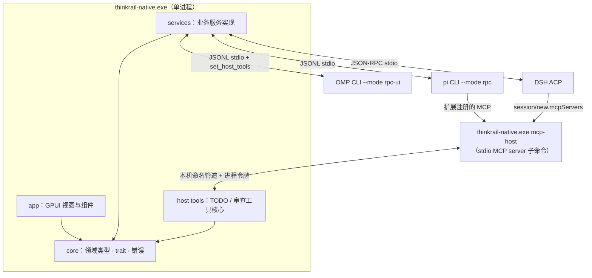
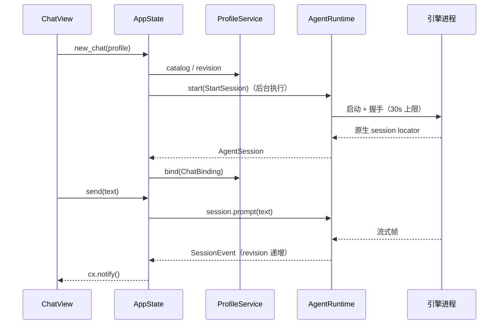

# 03 概要设计

事实见 [调研](01-research.md)，取舍见 [规划](02-plan.md)，接口见 [详细设计](04-detail.md)。

## 1. 系统结构

不新增任何 Agent loop。应用只负责启动引擎进程、翻译协议，并提供宿主工具。不嵌入 JS SDK，不开网络监听；MCP 子进程与主进程之间只走带令牌的本机命名管道。

## 2. Crate 分层与依赖

| crate | 职责 | 允许依赖 | 禁止 |
|---|---|---|---|
| `crates/core` | 领域类型、强类型 id、服务 trait、错误枚举、事件 | serde、thiserror、uuid | GPUI、文件系统和进程实现 |
| `crates/services` | trait 的实现：工作区 / Git / 文件、档案、计划审查、PTY、三个 AgentRuntime、宿主工具核心、MCP server | core，以及 std、portable-pty、fs2、sha2 等 | GPUI；业务状态只能经 trait 暴露 |
| `crates/app` | GPUI 应用：主题、组件、视图、启动、日志初始化 | core、services（只在组装根实例化）、gpui-kit、tracing-* | 视图直接读写文件或启动进程 |

规则：

- **面向接口**：视图和应用状态只持有 `Arc<dyn WorkspaceService>`、`Arc<dyn AgentRuntime>` 这类 trait 对象。具体类型只在 `app::bootstrap` 组装根里创建一次。测试可以注入其他实现。
- **模块边界**：每个 crate 的 `lib.rs` 是唯一公共入口；`pub(crate)` 以下属于内部实现，兄弟模块之间不能越过入口互相引用。
- **组件化**：无状态 UI 元素实现 `RenderOnce`（如 PanelHeader、TreeRow、Tab、IconButton），有状态视图是 `Entity<T>`，跨视图通信用 `EventEmitter` 和 `Subscription`。
- 不建插件框架、通用事件总线或第二套领域层。

## 3. 状态归属

| 状态 | 权威所有者 | 其他层保存的内容 |
|---|---|---|
| 项目、worktree 注册表 | `WorkspaceService`（`<data>/workbench.json`） | 视图投影，按代际丢弃过期响应 |
| Git、文件内容 | 磁盘与 Git 本身 | 只读投影；文件变化后标记过期 |
| Agent 档案、聊天绑定 | `ProfileService`（`<data>/agent-profiles.json`） | 非敏感摘要 |
| 引擎 transcript、模型、压缩、原生子任务 | 对应引擎的原生存储 | `SessionSnapshot` 投影，按 revision 单调更新 |
| 计划项、审查评论 | `PlanReviewService`（`<data>/review-plan.json`） | 视图投影 |
| 待回答的交互 | 引擎持有 continuation；`AgentSession` 持有可路由的请求 | 界面展示；关闭界面视为取消 |
| PTY 进程 | `TerminalService` | vt100 屏幕网格（只在视图里） |
| 终端标签目录 | `TerminalService`（`<data>/terminals.json`） | 视图投影 |
| 窗口布局、当前标签、选区 | 各 GPUI 窗口 | 不持久化（本期） |
| 引擎凭据、模型路由 | 引擎自己的配置目录 | 档案只保存配置目录路径和环境变量名 |

所有持久化文件都采用：OS 锁内重读 → 修改 → 写临时文件并 `sync` → 原子 rename。损坏的数据报 `Corrupt` 错误，不会被覆盖。

## 4. 进程与作用域

- **每个聊天一个引擎子进程**，以 `(profileId, configRevision)` 启动。档案的配置目录和环境变量只注入这个子进程；继承来的环境会先剔除凭据类变量（`*_API_KEY`、`*_TOKEN` 等）和引擎配置变量。
- **会话恢复**：引擎进程退出后聊天进入 `Closed`。下一条 prompt 用绑定中的 `NativeSessionKey` 恢复，并使用创建时的同一档案版本。修改档案只影响新聊天。
- **MCP 子进程**：引擎按需拉起 `thinkrail-native.exe mcp-host`，它带着进程令牌连接主进程的命名管道。主进程维护“令牌 → 聊天”映射，因此引擎切换会话不会让工具调用错发到别的聊天。
- **退出**：先停止接收新请求，再取消待答交互，然后让引擎正常退出（关闭 stdin，DSH 用 `session/close`），超过时限才结束整个进程树，最后释放 PTY。

## 5. 核心流程

### 5.1 新建聊天与发送

握手没有拿到真实的原生 locator，就不创建聊天。绑定保存失败时，释放刚启动的会话并报错。

### 5.2 交互与审批

引擎发出提问或权限请求后，会话进入 `Waiting`，交互卡显示在界面上。只有用户显式回答才会回发引擎；关闭卡片、停止或者引擎退出都按取消处理。不会自动批准。

### 5.3 宿主工具调用

Agent 调用 `todo_*`、`resolve_comment`、`request_review` 时：

- OMP 经由 `host_tool_call` 帧发起。
- pi 和 DSH 经由 `mcp-host` 子进程，通过命名管道转到主进程。

主进程的工具核心按聊天作用域执行，结果原路返回。界面里的计划和审查视图通过同一个服务读取数据，所以 Agent 改了什么，界面马上能看到。

## 6. 原生工作台

界面对标原版 ThinkRail 的 Balanced 布局：

- 40px 顶栏：品牌标识，以及项目 / 工作区 / 分支三段位置信息、连接状态和设置。
- 左侧活动栏 + Projects 树。
- 中间是聊天列（页签条、消息流、输入框）。
- 右侧是文件 / Diff，以及 Changes 面板。
- 终端放在底部面板。

主题色板、语义角色、尺寸和字体逐值取自原版数据（04 §9），不另外定义一套色板。
