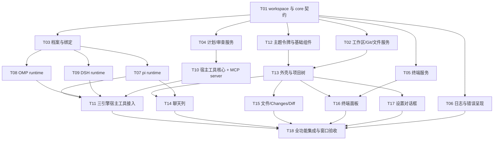

# 05 开发任务与验收

开发执行入口。先读 [README](README.md)、[规划](02-plan.md)、[概要](03-architecture.md)、[详细](04-detail.md)。

## 1. 执行方式

1. 一个任务只有一个集成负责人：先确定 core 中的 trait 和类型，再实现功能、迁移所有调用者、补测试、更新文档。
2. 不写空实现、占位界面、mock 兜底或自动批准。能力为 true 的项，必须有实测证据。
3. 测试只使用临时目录、隔离的引擎配置目录和占位凭据，不接触生产用户数据和真实凭据。会产生模型费用的测试，必须先征得用户同意。
4. 界面相关的任务必须在真实窗口中操作验证；键盘输入只发给已确认获得焦点的测试窗口。
5. 每个任务结束都做一次减法：删除过时代码、别名和重复状态，以及临时探针。

## 2. 任务依赖



## 3. 任务包

| 任务 | 范围 | 完成标准 |
|---|---|---|
| T01 | `Cargo.toml` workspace、`crates/core`（id、错误、各领域类型、trait） | core 编译通过并有单测；services 和 app 只通过 trait 依赖 core |
| T02 | `services::workspace` 实现 `WorkspaceService` | 迁移原有路径约束、worktree 归属和 Git 测试，全部通过 |
| T03 | `services::profiles` 实现 `ProfileService`（只接受 external launch） | 版本冲突、损坏数据不覆盖、锁竞争、绑定不随默认档案变化 |
| T04 | `services::plan_review` 实现 `PlanReviewService` | 单一 in_progress、done 不可删、锚点重定位、stale 阻止发送、fs2 锁内重读 |
| T05 | `services::terminal` 实现 `TerminalService` | 真实 ConPTY 测试：输入输出、resize、回放偏移、退出码、关闭、背压 |
| T06 | `app::logging`、错误到界面提示的映射、clippy lint | 日志文件生成且按日滚动；不含敏感字段；错误提示附带 code |
| T07 | `services::agents::pi` | 真实握手测试；帧解析、交互回复、`agent_settled` 判定完成 |
| T08 | `services::agents::omp` | 真实握手测试（v2 协商、`set_ask_dialog`、`set_host_tools`）；没有模型时报错可读 |
| T09 | `services::agents::dsh` | 从 npm 发布版做真实 ACP 握手；cancel、close、权限回复 |
| T10 | `services::host_tools`、`mcp-host` 子命令、命名管道、令牌映射 | 工具语义单测；用 MCP 客户端测试 initialize、list 和 call |
| T11 | pi 扩展文件、DSH `mcpServers`、OMP host tools 接线 | 三个引擎各自真实发现到工具（不需要发送模型请求） |
| T12 | `app::theme`（取自原版数据）、字体注册、`app::components` | 令牌逐值与原版一致（有测试）；组件都由 props 驱动 |
| T13 | 顶栏、活动栏、Projects 面板、工作区切换 | 真实窗口中打开项目、新建和切换工作区，与截图对照 |
| T14 | 聊天页签、消息流、交互卡、输入框、模型和档案显示 | 用 pi 真实会话发送（需用户同意）；或者只握手不发送，并如实标注 |
| T15 | 文件阅读、Changes 列表 / 树、Diff | 真实仓库中查看改动和 diff，与截图对照 |
| T16 | 底部终端面板（vt100 绘制、IME、复制） | 真实窗口中新建终端、输入命令、看到输出 |
| T17 | 设置对话框：档案增删改、设为默认 | 窗口中完成一次档案创建并设为默认 |
| T18 | 组合验收、清理旧的扁平模块、更新 SPEC 和 README | 第 4 节中适用的项全部有证据 |

## 4. 验收矩阵

状态：✅ 已有实测证据 · 🟡 部分完成 · ⬜ 未开始。状态以本表为准，不以聊天记录为准。

| 编号 | 场景 | 状态 | 证据 / 说明 |
|---|---|---|---|
| V01 | 原生窗口启动与渲染 | ✅ | 新架构 debug 构建在真实窗口启动：顶栏、活动栏、Projects、聊天列、Diff / Changes、终端按原版 Balanced 布局渲染 |
| V02 | 打开项目、选择工作区、阅读中文文件 | 🟡 | 新架构窗口重启后恢复中文项目「仓库 smoke」与默认工作区，Changes 列出中文文件名；本轮未在窗口中重新打开文件 |
| V03 | 新建 / 删除 worktree，归属保护 | 🟡 | 单测覆盖；窗口中未操作 |
| V04 | Git 状态、diff、checkout | 🟡 | 单测覆盖；窗口中未操作 |
| V05 | 终端 ConPTY 生命周期 | ✅ | ignored 测试 `windows_pty_lifecycle_smoke` 通过 |
| V06 | 终端窗口交互 | ✅ | 真实窗口中打开终端面板，经 WM_CHAR 输入 `echo 终端中文-ok2; (Get-Location).Path`，看到中文输出与普通 `C:\…` 路径（已去掉 `\\?\` 前缀） |
| V07 | pi 官方 RPC 握手 | ✅ | `PiRuntime`，pi 1.4.0 + Node v24.21.0，隔离配置目录：`get_state` 得到 locator、`get_messages` 回放、dispose 后 `Closed` 且无错误（ignored 测试 `smoke::pi_rpc_handshake`） |
| V08 | OMP 官方 RPC 握手 | ✅ | `OmpRuntime`，npm 18.13.3 + Bun 1.4.4：`ready` → v2 协商 → delta 事件过滤 → `set_ask_dialog` →（启用时）`set_host_tools` → `get_state` → 分页回放；无模型时报 `BACKEND_UNAVAILABLE` 并提示 models.yml（`smoke::omp_*`） |
| V09 | DSH ACP 握手 | ✅ | `DshRuntime`，npm 0.2.1-rc.5 + Node v24.21.0：`initialize`、`session/new`、`session/close`，新进程 `session/resume` 同一 locator（`smoke::dsh_acp_handshake_and_resume`）；启用宿主工具时带 `--patch` 关闭 `tool-todo` |
| V10 | 聊天发送、流式输出、停止、恢复 | ✅ | 真实窗口 + pi 1.4.0 + 用户中转模型（easyclaude / claude-opus-5-5，经用户同意）：关闭的会话按 locator 恢复；长文本逐步流式增长；运行中点停止后回到空闲，pi 会话记录该轮 `stopReason: aborted`；模型调用 `mcp__thinkrail__todo_list` / `todo_update` 后 TODO 条由 `1/3` 变为 `2/3`。无凭据时显示可读错误。OMP 18.13.3 + 同一中转：发送、正文流式中停止（`abort` → `session_settled`，已写 12852 字）、宿主工具 `todo_add` / `todo_list`；停止后下一条消息不再续做被停止的请求（`navigate_tree` 撤回，见 01-research）。DSH 0.2.1-rc.5 经 `acp` 覆盖走同一中转（`anthropic/claude-opus-5`）：发送、分块流式、停止后回到空闲且下一条不续做旧请求、宿主工具 `mcp__thinkrail__todo_add` / `todo_list`（TODO 条 `0/1`） |
| V11 | 交互：提问与权限，不自动批准 | ✅ | OMP 真实窗口：`ask` 单选卡选择后模型复述答案；权限卡不点击时一直等待、不执行；点“拒绝”后不写文件；点“本会话批准”后执行。DSH 真实窗口：工作区内写文件按 `workspace-write` 沙箱直接执行、不弹卡（DSH 设计如此）；写工作区外文件触发 `session/request_permission`，不点击时等待，点 Reject 后工具失败、文件未创建，点 Allow once 后写出 |
| V12 | 档案隔离：凭据不串用 | 🟡 | 环境剔除有单测；两个档案并发未测 |
| V13 | 宿主工具：三个引擎都能发现 | ✅ | 临时集成烟测（已删除）用真实 `thinkrail-native.exe`：pi 1.4.0 经 `-e` 扩展、DSH 经 `mcpServers` 各自拉起 `mcp-host`，经命名管道和令牌完成 `tools/list`；OMP 18.13.3 接受 `set_host_tools` 后握手成功。pi 发给模型的工具列表含 `mcp__thinkrail__todo_*` 与 `resolve_comment`，并真实调用了 `mcp__thinkrail__todo_write` |
| V14 | 计划 / 审查语义 | 🟡 | 工具核心与命名管道端到端单测（`thinkrail-host-tools`）；真实窗口中 pi 调用 `todo_write` 后 TODO 条显示 `1/3`，展开为分组与三种状态。审查评论尚无界面 |
| V15 | 设置对话框管理档案 | 🟡 | 真实窗口：齿轮打开设置；新建 OMP、DSH（标“预发布”）档案后写入 `agent-profiles.json`；编辑后保存生成版本 2，列表显示“版本 2”；取消编辑不关闭对话框。设为默认、删除未在窗口中操作 |
| V16 | 界面与原版截图对照 | 🟡 | 与 `workbench-dark.png` 对照：布局、色板、顶栏、Projects、TODO 条、用户气泡、工具卡、Changes 一致；Specs 面板按 §5 不做；输入框下方无模型选择器（模型显示在聊天头部） |
| V17 | 日志与错误规范 | 🟡 | 日志写 `<data>/logs`，失败只记 `code`；错误横幅显示码和可读消息；stderr 摘要按 04 §2.3 脱敏（单测）。未逐项审计 |
| V18 | 损坏数据不被覆盖 | ✅ | 档案、工作区、计划审查、终端目录各有单测 |

## 5. 后续阶段（本期不做，不放占位界面）

PR 创建与查看、Specs 图、十一类资源专用预览、安装包与更新、多语言、窗口布局持久化。

## 6. 交接提示模板

```text
任务：实施 docs/design/native-multi-agent/05-development.md 中的 Txx。
先读 README、02、03、04 中与本任务相关的章节，以及 crates/core 中的相关 trait。
- 只改本任务范围内的文件；trait 有变动时，迁移所有调用者。
- 遵守 04 §2 错误规范和 §3 日志规范；非测试代码禁止 unwrap / expect。
- 界面只引用 app::theme 的令牌；视觉以原版数据和截图为准。
- 真实进程使用临时目录和隔离配置目录；禁止自动批准，禁止 mock 兜底。
完成后：运行相关测试和窗口验证，更新第 4 节对应行的状态和证据，汇报改动文件和实际运行的命令。
```
